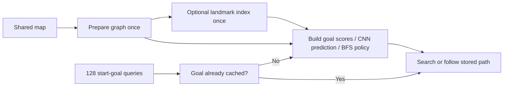

# Step 3: changing goals on a shared map

The previous pilot found a landmark speed benefit on wall maps with a shared goal, but no added CNN benefit. This final bounded diagnostic changes how often goals repeat. The question is whether a map-level landmark index becomes more useful when reverse BFS and the CNN must prepare new goals. No training or new test set is involved.

## Workload and controls

Use the same 40 validation maps and frozen 8-channel seed-7 checkpoint as step 2. Each session contains 128 queries on one map. Compare 1, 8, and 128 distinct goals, giving 128, 16, or one query per goal. Five shuffled repetitions produce 3,000 sessions and 384,000 query executions.

Select 128 distinct goals deterministically from free cells, then select 128 distinct starts outside that goal pool. Keep the same start sequence for all three workloads. Query `q` uses goal `q % goal_count`, so goals recur in a round-robin order. Keep unreachable pairs. Generate labels by reverse BFS for each sampled goal before timing. The new goals differ from step 2, so compare methods within this run. Across goal counts, endpoints and query difficulty also change; this is not a pure causal estimate of goal count alone.

All five methods prepare the graph once per measured session. Landmark methods also build the same four-corner index once. Each method keeps a per-goal cache within that session: Manhattan and landmark A* cache goal-specific score fields and planners, CNN methods predict once for each new goal, and reverse BFS stores distances and next steps for each new goal. Cache entries persist until the session ends. Nothing is shared across measured sessions or methods. This permits equal reuse for all controls and charges every cache miss.

## Measurement and checks

Time graph and landmark preparation, every goal-specific prediction and planner or policy build, search, and path output. The total also includes loop and cache-lookup overhead. Retain this overhead separately rather than dropping it from the total. Model weights are resident; record the one-time load separately. As before, dataset I/O, Python/library startup, warmup, verification, and evidence saving are outside method timers.

Use one CPU thread. Warm each method on open 32×32 and 64×64 grids. Shuffle maps and method/workload combinations within each repetition. Freeze settings, source, arrays, checkpoint, and generated query labels before timing. Check optimal paths and unreachable cases after timing. Repeated paths and all search counters must agree, and each method must prepare exactly the expected number of goals.

For each map and method, take the median of five total session times and retain all components from that same repetition. Divide by 128 for per-query time. Average maps equally within each of the four map families. Use paired ratios and 2,000 whole-map bootstrap draws for pointwise 95% intervals. Retain per-map medians, paths, preparation counts, and unreachable counts. Model effects must be compared directly with the corresponding method without a CNN.

This is a small validation comparison with 10 maps per family and one model seed. The implementation constructs full score fields for each new goal; it does not represent every possible landmark implementation. Caching many goals also uses more memory; this pilot measures latency, not memory limits. It is not a fresh-test claim or a reason by itself to start another training sweep.

Settings are in [changing_goals.toml](../configs/changing_goals.toml). Run `scripts/run_changing_goals.py prepare`, then `evaluate`, using the project environment. After this diagnostic, prioritize the final report, presentation, and reproducible terminal demo for the remaining week.
