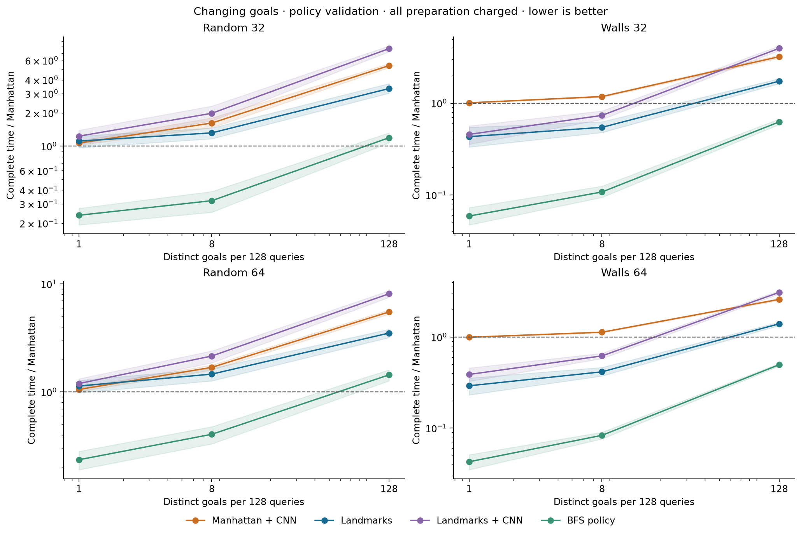

# Step 3: changing-goal results

This [fixed validation pilot](changing_goals.md) reuses the same 40 maps and frozen 8-channel seed-7 model. Every session has 128 queries, with 1, 8, or 128 distinct goals. No model was trained and no fresh test set was used.

With 128 distinct goals, landmark-only search is slower than Manhattan in all four families. The CNN adds further cost. Manhattan has the lowest mean time on the random families, while reverse BFS has the lowest mean on walls. Reusing the landmark index does not cover the cost of constructing full goal-specific score fields in this implementation.

## Complete query time

Values are mean milliseconds per query after taking each map's median session. They include map preparation, all goal-cache misses, search, path output, and loop overhead. The model is resident. Lower is better.

| Condition | Goals | Manhattan | Manhattan + CNN | Landmarks | Landmarks + CNN | BFS policy |
| --- | ---: | ---: | ---: | ---: | ---: | ---: |
| Random 32 | 1 | 0.0734 | 0.0773 | 0.0748 | 0.0834 | 0.0156 |
| Random 32 | 8 | 0.0942 | 0.1488 | 0.1209 | 0.1793 | 0.0276 |
| Random 32 | 128 | 0.1866 | 1.0052 | 0.6268 | 1.4308 | 0.2201 |
| Walls 32 | 1 | 0.3000 | 0.3015 | 0.1159 | 0.1213 | 0.0156 |
| Walls 32 | 8 | 0.2567 | 0.3009 | 0.1343 | 0.1827 | 0.0264 |
| Walls 32 | 128 | 0.3454 | 1.1022 | 0.5943 | 1.3561 | 0.2136 |
| Random 64 | 1 | 0.2349 | 0.2492 | 0.2501 | 0.2657 | 0.0502 |
| Random 64 | 8 | 0.2532 | 0.4182 | 0.3494 | 0.5147 | 0.0950 |
| Random 64 | 128 | 0.6088 | 3.3212 | 2.1030 | 4.8693 | 0.8595 |
| Walls 64 | 1 | 1.4264 | 1.4166 | 0.3771 | 0.5153 | 0.0550 |
| Walls 64 | 8 | 1.2123 | 1.3652 | 0.4921 | 0.7415 | 0.0987 |
| Walls 64 | 128 | 1.7147 | 4.4401 | 2.3914 | 5.2962 | 0.8495 |

## Paired comparisons

Ratios are computed per map, then averaged equally over 10 maps per family. Brackets are pointwise 95% whole-map bootstrap intervals. Below one favors the numerator; an interval crossing one does not establish a difference. These ratios can differ from dividing the overall mean latencies above.

| Condition | Goals | Landmarks / Manhattan | BFS / Manhattan | Landmarks + CNN / landmarks |
| --- | ---: | ---: | ---: | ---: |
| Random 32 | 1 | 1.113 [0.967, 1.235] | 0.236 [0.193, 0.273] | 1.104 [1.036, 1.192] |
| Random 32 | 8 | 1.320 [1.169, 1.462] | 0.320 [0.251, 0.388] | 1.496 [1.405, 1.595] |
| Random 32 | 128 | 3.337 [3.026, 3.705] | 1.193 [1.073, 1.324] | 2.330 [2.196, 2.440] |
| Walls 32 | 1 | 0.432 [0.332, 0.546] | 0.059 [0.047, 0.073] | 1.092 [0.971, 1.196] |
| Walls 32 | 8 | 0.545 [0.478, 0.628] | 0.108 [0.094, 0.125] | 1.363 [1.305, 1.415] |
| Walls 32 | 128 | 1.738 [1.633, 1.854] | 0.625 [0.585, 0.672] | 2.282 [2.261, 2.305] |
| Random 64 | 1 | 1.137 [0.981, 1.280] | 0.237 [0.191, 0.283] | 1.065 [1.008, 1.125] |
| Random 64 | 8 | 1.464 [1.269, 1.652] | 0.407 [0.332, 0.479] | 1.474 [1.449, 1.498] |
| Random 64 | 128 | 3.506 [3.188, 3.809] | 1.441 [1.269, 1.608] | 2.322 [2.266, 2.384] |
| Walls 64 | 1 | 0.291 [0.231, 0.354] | 0.043 [0.035, 0.051] | 1.372 [1.270, 1.453] |
| Walls 64 | 8 | 0.415 [0.373, 0.464] | 0.083 [0.076, 0.090] | 1.515 [1.432, 1.584] |
| Walls 64 | 128 | 1.400 [1.338, 1.457] | 0.497 [0.481, 0.514] | 2.217 [2.168, 2.264] |

## What happens when every query has a new goal?

This breakdown uses 128 goals. All values are milliseconds per query. Setup includes the graph, landmark index, goal score fields, predictions, and BFS preparation where applicable. Other time includes cache lookups and loop overhead. Components come from the same repetition as the median total.

| Condition | Method | Setup | Of which CNN | Search/output | Other | Total |
| --- | --- | ---: | ---: | ---: | ---: | ---: |
| Random 32 | Manhattan | 0.1130 | 0.0000 | 0.0730 | 0.0005 | 0.1866 |
| Random 32 | Manhattan + CNN | 0.9286 | 0.6793 | 0.0752 | 0.0014 | 1.0052 |
| Random 32 | Landmarks | 0.5580 | 0.0000 | 0.0680 | 0.0008 | 0.6268 |
| Random 32 | Landmarks + CNN | 1.3617 | 0.6870 | 0.0678 | 0.0014 | 1.4308 |
| Random 32 | BFS policy | 0.2155 | 0.0000 | 0.0040 | 0.0006 | 0.2201 |
| Walls 32 | Manhattan | 0.1055 | 0.0000 | 0.2393 | 0.0006 | 0.3454 |
| Walls 32 | Manhattan + CNN | 0.8608 | 0.6297 | 0.2403 | 0.0011 | 1.1022 |
| Walls 32 | Landmarks | 0.5076 | 0.0000 | 0.0860 | 0.0006 | 0.5943 |
| Walls 32 | Landmarks + CNN | 1.2637 | 0.6316 | 0.0913 | 0.0011 | 1.3561 |
| Walls 32 | BFS policy | 0.2080 | 0.0000 | 0.0050 | 0.0006 | 0.2136 |
| Random 64 | Manhattan | 0.4089 | 0.0000 | 0.1994 | 0.0006 | 0.6088 |
| Random 64 | Manhattan + CNN | 3.1149 | 2.2090 | 0.2049 | 0.0014 | 3.3212 |
| Random 64 | Landmarks | 1.9231 | 0.0000 | 0.1790 | 0.0008 | 2.1030 |
| Random 64 | Landmarks + CNN | 4.6874 | 2.2736 | 0.1801 | 0.0018 | 4.8693 |
| Random 64 | BFS policy | 0.8517 | 0.0000 | 0.0071 | 0.0007 | 0.8595 |
| Walls 64 | Manhattan | 0.4111 | 0.0000 | 1.3029 | 0.0008 | 1.7147 |
| Walls 64 | Manhattan + CNN | 3.1343 | 2.2264 | 1.3042 | 0.0017 | 4.4401 |
| Walls 64 | Landmarks | 2.0369 | 0.0000 | 0.3536 | 0.0009 | 2.3914 |
| Walls 64 | Landmarks + CNN | 4.8466 | 2.3052 | 0.4476 | 0.0020 | 5.2962 |
| Walls 64 | BFS policy | 0.8362 | 0.0000 | 0.0126 | 0.0007 | 0.8495 |

## Correctness and scope

The run completed 3,000 sessions and 384,000 query executions in 337.1 seconds of measurement-stage wall time, including checking and saving evidence. All methods returned optimal costs or correct no-path results. The archive retains 76,800 full query outcomes and 600 median sessions. Every repeated path and search counter matched.

Verification regenerated the deterministic endpoints, recomputed labels through a separate prepared-BFS implementation, checked every saved path, and reconstructed each session signature. It also checked all frozen hashes and cross-checked 240 latency and paired-ratio means with standard-library calculations.

One observed model load took 16.94 ms. That one-time cost is reported separately from resident-model session times. Divide it by 128 to obtain the extra per-query charge for a first session in an initialized process. Python/library startup, dataset I/O, warmup, and evidence verification are outside all method timers; this is not a cold-start measurement.

The changing-goal workload also changes query endpoints and difficulty. Method comparisons within a workload are paired, but differences across goal counts should not be attributed solely to cache reuse. These are small validation results from one model seed, not held-out generalization claims. The implementation builds full goal-specific score fields; more efficient on-demand landmark implementations were not tested. Goal caches also use memory, whose peak usage was not benchmarked.

The one- and eight-goal workloads still favor landmark-only over Manhattan on walls, but reverse BFS is faster there. When every goal is new, the landmark index itself is still built only once; most setup time moves to goal-specific score construction. The CNN likewise needs a new prediction per goal. These measurements identify implementation costs, not an inherent limit of all landmark heuristics or learned search methods.

Given the remaining project week, stop expanding this research branch. Retain the negative model result and the classical wall-map improvement as separate findings. Prioritize a clear final report, an updated presentation, and a reproducible terminal demonstration. On-demand landmark scoring can be listed as future work without claiming an unmeasured speedup.

The [archive](../results/primary_step3/) contains settings, selected maps, query labels, source hashes, raw sessions and paths, medians, and complete summaries.
