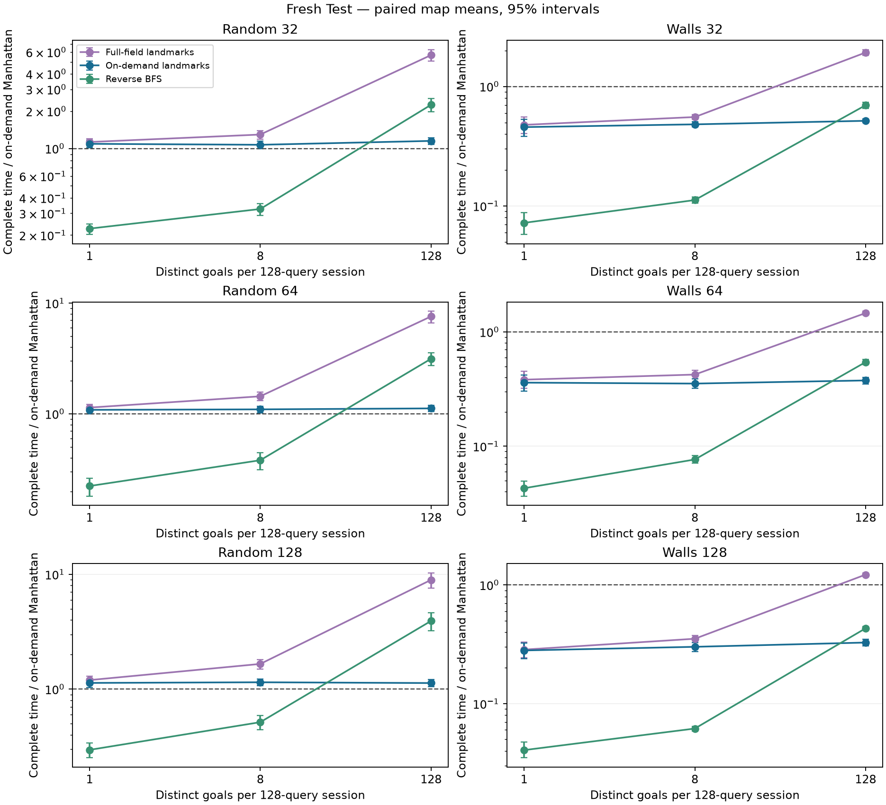

# On-demand heuristic results

Computing landmark scores only when search requests them removes most of the preparation cost observed in the previous changing-goal study. On 120 fresh maps, the new landmark implementation beats both Manhattan implementations and reverse BFS on wall workloads with 128 distinct goals. It remains slower than on-demand Manhattan on random maps under that workload. With one or eight shared goals, reverse BFS has the lowest mean time in all six map families.

This is a classical implementation improvement, not a neural-network gain. The same landmark bounds, paths, and search counters are preserved. It does not establish a new A* algorithm or a universally fastest method.

## Validation before fresh testing

The [fixed protocol](demand_heuristic.md) first used the same 40 validation maps and endpoints as the changing-goal study. At 128 goals, on-demand landmark time divided by full-field landmark time was 0.273 [0.264, 0.282] on walls 32 and 0.258 [0.248, 0.269] on walls 64. Both passed the predeclared gate: a mean ratio at most 0.95 and an interval upper bound below one, with correct and identical search results. Passing this gate justified fresh testing; it did not by itself establish a win over Manhattan.

The implementation and workload settings stayed fixed for the test. Its 120 new layouts exclude all 6,800 earlier layout groups, including rotations. There are 20 random and 20 wall maps at each size, 32×32, 64×64, and 128×128. Each random family balances 10% and 25% obstacles. The 128×128 cases extend the study beyond the earlier pilot sizes. No model was trained or selected from these results.

## Fresh test: a different goal for every query

Each session has 128 queries on one map. In this workload, all 128 goals are distinct. Values below are mean milliseconds per query after selecting each map's median session from five shuffled repetitions. They include graph and landmark preparation, goal-specific setup, score calculation, search, and full path construction. Both Manhattan variants use the same prepared search loop as the landmark variants.

| Condition | Full-field Manhattan | On-demand Manhattan | Full-field landmarks | On-demand landmarks | Reverse BFS |
| --- | ---: | ---: | ---: | ---: | ---: |
| Random 32 | 0.1649 | 0.0971 | 0.5224 | 0.1085 | 0.2052 |
| Walls 32 | 0.3269 | 0.3065 | 0.5779 | 0.1562 | 0.2090 |
| Random 64 | 0.5679 | 0.2809 | 2.0073 | 0.3061 | 0.8223 |
| Walls 64 | 1.6127 | 1.5721 | 2.2890 | 0.5901 | 0.8537 |
| Random 128 | 2.3254 | 1.0428 | 8.2613 | 1.1250 | 3.5725 |
| Walls 128 | 7.9924 | 8.2386 | 10.0444 | 2.7046 | 3.5463 |

The next table gives paired time ratios for on-demand landmarks. Each ratio is computed within a map before averaging equally over the 20 maps. Brackets are pointwise 95% whole-map bootstrap intervals; below one favors landmarks. These ratios need not equal division of the overall mean times above.

| Condition | / On-demand Manhattan | / Full-field Manhattan | / Reverse BFS |
| --- | --- | --- | --- |
| Random 32 | 1.152 [1.082, 1.222] | 0.659 [0.641, 0.677] | 0.536 [0.497, 0.583] |
| Walls 32 | 0.516 [0.496, 0.535] | 0.480 [0.467, 0.494] | 0.746 [0.722, 0.771] |
| Random 64 | 1.120 [1.050, 1.196] | 0.538 [0.524, 0.552] | 0.381 [0.347, 0.419] |
| Walls 64 | 0.376 [0.351, 0.401] | 0.368 [0.342, 0.395] | 0.697 [0.648, 0.750] |
| Random 128 | 1.131 [1.053, 1.211] | 0.480 [0.462, 0.499] | 0.323 [0.284, 0.366] |
| Walls 128 | 0.327 [0.305, 0.348] | 0.337 [0.313, 0.362] | 0.760 [0.715, 0.808] |

Against on-demand Manhattan, paired mean time falls by 48.4%, 62.4%, and 67.3% on wall maps at sizes 32, 64, and 128. All three intervals stay below one, and comparisons with full-field Manhattan also favor landmarks. Full-field Manhattan is slightly faster than on-demand Manhattan on walls 128, so both controls matter. Reverse BFS is also slower than on-demand landmarks in these three changing-goal wall workloads.

On random maps, on-demand landmarks take about 12–15% more paired time than on-demand Manhattan at 128 goals. Comparing only with full-field Manhattan would incorrectly suggest that landmarks win in every family. Giving the same preparation change to the baseline is essential.

## What changes with goal reuse?

For one or eight goals shared across the 128 queries, reverse BFS has the lowest mean time in every family. Its exact next steps are reused, making repeated route extraction inexpensive. On-demand landmarks still improve over Manhattan on walls, but they do not beat this stronger control under those reuse levels.

The crossover between eight and 128 goals was not measured more finely. Different goal-count workloads also change query endpoints and difficulty, so their differences are not a pure causal estimate of reuse. The [full tables](../results/demand_heuristic/test/tables.md) retain all methods and all three workloads, including the cases without a landmark advantage.

## Where the time goes

On walls 64 with 128 goals, full-field landmarks spend 1.9593 ms/query in setup and 0.3288 ms/query in search, for a total of 2.2890 ms/query including loop overhead. On-demand landmarks spend 0.0817 ms/query in setup and 0.5077 ms/query in search, totaling 0.5901 ms/query. Scoring now happens inside search when needed, so the search components do not represent identical work. The complete measured session still becomes substantially faster.

The on-demand landmark caches store the following fraction of the full-field score entries at 128 goals. Both variants still build the same four-landmark index; that work is charged separately in the session.

| Condition | Stored on-demand scores / full-field scores |
| --- | ---: |
| Random 32 | 6.6% |
| Walls 32 | 10.2% |
| Random 64 | 4.0% |
| Walls 64 | 8.5% |
| Random 128 | 2.8% |
| Walls 128 | 8.1% |

These fractions count evaluated and retained grid scores, including blocked positions in the full-field denominator. They are not RAM savings: dictionaries, tuples, integers, and floats have different storage costs. The full-field landmark path converts scores to floats, while on-demand scores remain integers. Values and search order are identical, but this study includes the costs of both evaluation and representation rather than isolating every operation.

## Evidence and limitations

Validation completed 3,000 sessions and 384,000 timed query executions in 198.9 seconds. Fresh testing completed 9,000 sessions and 1,152,000 timed query executions in 1,687.9 seconds, including correctness checks and evidence writing in the stage wall time. These repeated executions are not independent maps. The archives retain 76,800 validation and 230,400 test query outcomes with full paths, plus 600 and 1,800 median sessions.

All measured paths had optimal cost or a correct no-path result. Every full-field/on-demand pair returned identical paths and search counters, and repetitions agreed. Verification independently regenerated endpoints and BFS labels, checked saved paths and result signatures, and cross-checked 300 validation and 450 test timing means and ratios. All 222 tests, code style, formatting, and dependency checks passed. Both figures were visually checked.

The timer includes setup and query processing but stops before final cache disposal. Startup, dataset loading, warm-up, evidence writing, and correctness checks are outside method timers. This is not a full application-lifecycle latency measurement. Results cover these Python implementations on one CPU setup, synthetic static grids, and 20 test maps per family. The intervals are pointwise, not adjusted across all comparisons. Peak memory, vectorized full-field implementations, other landmark placements, and real navigation maps were not tested.

The result strengthens an implementation-specific conclusion: the earlier changing-goal landmark loss was largely a preparation bottleneck, not an unavoidable consequence of changing goals. It does not overturn the negative CNN timing result, because the CNN is absent from this experiment. The stronger classical control should remain in future learned-method comparisons.

A reasonable next learning hypothesis is to select between Manhattan, landmarks, and reverse BFS from cheap map features and the known query workload. Such a selector would need separate training and validation data, a fresh test set, and a simple hand-written selection rule as a control. Feature extraction and prediction must be charged. This is a proposed direction, not an implemented or measured learned improvement.

The [evidence archive](../results/demand_heuristic/) includes map arrays, frozen settings, source hashes, raw measurements, full paths, summaries, and PNG/PDF figures. Its independent arithmetic checker runs without the original generated dataset directories.
