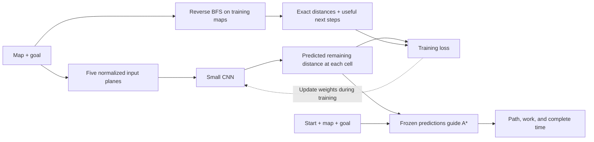

# Learning heuristics for A*: research synthesis

## Research question and conclusion

Can a small neural network use obstacle information to help A* find shortest paths with less work and lower total time than Manhattan A*? We study this on fully known grids with four-way movement and unit step costs. We measure prediction quality, expanded cells, total time, and path quality separately.

The model learned useful search preferences. With predictions used only to order equal Manhattan priorities, it reduced expansions on fresh random and wall 32×32 maps while preserving shortest paths. However, prediction and preparation costs outweighed these savings. Smaller networks and prediction reuse narrowed the gap without establishing a reliable runtime win over equally prepared Manhattan A*.

Later diagnostics explain part of this result. Changing only tie order leaves little room on the measured wall maps. A classical landmark heuristic can change the main search priority, but adding the frozen CNN did not improve it. The initial landmark diagnostics use validation maps. A subsequent on-demand implementation study adds 120 fresh test maps and confirms a classical speed benefit on changing-goal wall workloads. This benefit is separate from the learned-model findings.

The contribution is a controlled empirical study of where learned guidance helps and where its costs dominate. It is not a new shortest-path algorithm or a claim that learned search cannot outperform A* in other settings. The [original report](report.md) describes the first experiment; this synthesis covers the subsequent research as well.

## What the model learns

The model receives a map and a goal. It does not generate obstacles or output a complete route. Its five input planes describe obstacles, the goal marker, signed row and column offsets from the goal, and Manhattan distance. The start is supplied to the search algorithm separately, so one prediction can serve several starts on the same map and goal.

Row and column offsets are scaled by the corresponding grid dimensions minus one. Distances are divided by `max(H + W - 2, 1)`. BFS supplies the exact remaining distance at each reachable free cell. Targets are not clipped at one because an obstacle detour may be longer than this scale. Blocked and unreachable cells are excluded from the training loss.

Distance-only training minimizes prediction error. The later route objective also rewards neighboring moves that reduce exact distance by one, accepting all equally good moves. Its weight is 0.02. This teaches local preferences; training does not differentiate through A* or directly minimize its measured runtime.

The later networks use five convolution blocks with dilations 1, 2, 4, 8, and 16. Hidden widths of 16, 8, and 4 have 10,033, 2,713, and 781 parameters. These widths describe internal features, not the five input planes. The original experiment used a wider 32-channel model. Architecture and settings are retained in the [architecture notes](research_architecture.md) and each experiment's protocol.

## How the methods differ

Here, `g` is the path cost already traveled and `h` estimates the remaining cost. A* explores the lowest `g + h` priority first. An optimal path means no shorter route exists; it does not mean the algorithm used the least time to find it.

| Method | How it chooses work | Path guarantee in this project | Main cost or limitation |
| --- | --- | --- | --- |
| Manhattan A* | Uses row distance plus column distance; favors larger `g` on ties. | Shortest paths. | Cheap estimate, but ignores obstacle detours. |
| Weighted A* | Multiplies Manhattan by a weight above one. | May return a longer path. | A speed–quality comparison, not an equal-quality replacement. |
| Direct learned heuristic | Uses predicted distance as `h`. | No shortest-path guarantee. | Predictions can overestimate, and inference takes time. |
| Manhattan with learned ties | Keeps `g + Manhattan` first; uses predicted distance only on equal priorities. | Shortest paths. | Cannot reorder cells with different primary priorities. |
| Landmark A* | Takes the maximum of Manhattan and lower bounds from precomputed landmark distances. | Shortest paths. | Pays for the landmark index and goal-specific score preparation. |
| Landmark with learned ties | Uses the landmark primary priority and CNN secondary score. | Shortest paths. | Adds inference to an already stronger classical method. |
| Reverse-BFS policy | Computes exact distances and next steps once per goal, then follows those steps. | Shortest paths. | Preparation must be repeated for a new goal; especially useful with reuse. |

The learned tie queue orders by `(g + Manhattan, predicted distance, -g, insertion order)`. It changes which equal-priority cell is explored first without replacing the admissible main estimate. Predictions are not used to discard cells. All methods return actual paths, including the reverse-BFS policy.

The landmark implementation uses up to four free cells near the corners. For each landmark `L`, the difference `|d(L, v) - d(L, goal)|` is a lower bound on the remaining distance in this undirected grid. We take the maximum with Manhattan and ignore unavailable distances. The [correctness study](primary_heuristic_step1.md) records exhaustive small-grid checks. This is a classical control, not a learned contribution.

## Experimental design and evidence

Training maps update weights, checkpoint-validation maps choose saved weights, and separate policy-validation maps choose search settings. Fresh test maps are generated after those choices. Layout separation also excludes rotated duplicates. Later diagnostic pilots reuse validation maps and are labeled accordingly. Test outcomes never retroactively change the selected configuration.

The route experiment trains three seeds on 1,200 mixed random/wall maps, with 240 checkpoint-validation maps. Another 240 maps select the search rule before 600 fresh test maps are evaluated. The width experiment adds six training runs, uses 120 policy-validation maps, and evaluates 300 fresh test maps. The reuse experiment freezes all nine width checkpoints and uses another 300 fresh test maps. The [individual protocols and archives](../README.md#follow-up-research) retain full split settings and query counts.

Measurements pair methods on the same endpoints. Runtime uses shuffled repeated runs on one CPU thread, with warm-up and median repetition times. Complete time includes method-specific preparation, inference, search, and path output. Reuse sessions pay setup once and divide the complete session time by their query count. We do not give exact preprocessing to a competing method for free. Diagnostic oracle lookups are explicitly separated from deployable timing comparisons.

Model loading, library startup, training, evidence writing, and correctness checks are outside query timing. Thus these are resident-model measurements, not cold application startup times. Prepared comparisons give Manhattan the same shared graph implementation. A faster implementation is not credited as a learned improvement.

Intervals resample whole maps, keeping paired method results together. They describe variation across maps for the fixed models, not uncertainty over every possible training seed or machine. A ratio below one favors the numerator. An interval crossing one does not establish a speed advantage or prove equivalence. Paired means average within-map ratios; they need not equal the ratio of two overall mean times. Absolute times should only be compared within an experiment.

### Fresh-test findings

| Experiment and comparison | Random 32×32 | Walls 32×32 | Interpretation |
| --- | --- | --- | --- |
| Route-trained ties: reachable expansions / Manhattan | 0.928 [0.913, 0.943] | 0.953 [0.933, 0.971] | Useful learned ordering with optimal paths. |
| Same experiment: CNN / Manhattan mean total ms | 0.682 / 0.087 | 0.917 / 0.307 | Fewer expansions did not produce lower complete time. |
| Width experiment: 16 / 8 / 4-channel mean total ms | 1.2990 / 0.8349 / 0.6359 | 1.8222 / 1.3346 / 1.1451 | Smaller models are faster than the 16-channel control. |
| Same width experiment: Manhattan mean total ms | 0.1988 | 0.6102 | All widths remain slower than Manhattan. |
| Reuse experiment, 8 channels and 64 starts: time / prepared Manhattan | 1.099 [1.081, 1.117] | 1.029 [1.008, 1.047] | Reuse narrows the gap but does not close it. |

Sources: [route-test summary](../results/research_v3/test/summary.json), [width-test summary](../results/research_v5/test/summary.json), and [reuse summary](../results/research_v6/summary.json). Brackets are pointwise 95% whole-map bootstrap intervals. Each row is an internal comparison from its own experiment, not a shared cross-experiment benchmark.

At 128 starts on wall maps, the 8-channel reuse ratio was **1.001 [0.981, 1.019]**. This is close to parity, not an established win. Reverse BFS was the fastest mean method in every tested family at 64 starts. Its upfront work is included, so predicting distances is competing with computing reusable exact routes.

The route experiment also includes a model trained without obstacle input. It reduces random-map expansions too, so that reduction alone cannot prove learned obstacle reasoning. It does not show a clear reduction on wall maps. This is a one-seed diagnostic; the stronger claim supported by the main comparison is useful learned ordering on the tested conditions.

Validation selected four channels for the width experiment. Eight channels retained stronger ordering, but that does not authorize changing the selected winner after viewing test results. Generalization was also limited: on the reuse experiment's 64×64 maps, the 8- and 4-channel models expanded about 2.8% and 5.9% more cells than Manhattan at 64 starts. Smaller prediction cost does not guarantee better search.

### Validation diagnostics: why further tie training stalled

The [ordering-limit study](order_pilot_results.md) evaluates 1,920 queries on 120 validation maps. Exact-information ordering reaches the calculated expansion floor on every measured query. With Manhattan primary priority fixed, the maximum paired expansion savings are 10.7% on random 32, 5.3% on walls 32, 19.1% on random 64, and 4.3% on walls 64. These are savings relative to ordinary Manhattan, not additional savings beyond the CNN. They apply to this search setup and measured queries, not all forms of A*.

A matched pilot continued the same 8-channel seed for 960 updates per branch. The candidate mixed old data with new wall and 64×64 maps; the control used old data only. Combined validation loss fell from 0.07376 for the control to 0.02848 for the candidate. However, the candidate's complete-time ratio to the frozen model was **0.999 [0.991, 1.007]** at 128 starts, averaged equally over four families. Neither distance nor detour ordering passed the fixed runtime gate. Lower loss therefore did not justify more seeds or a new test set. This is one-seed validation evidence, not a general claim that additional training cannot work.

### Validation diagnostics: stronger priorities and changing goals

The landmark pilots use 40 validation maps, ten per random/wall and 32/64 family, with one frozen 8-channel seed. The following table compares landmark-only time to Manhattan within each workload:

| Workload | Walls 32×32 | Walls 64×64 |
| --- | --- | --- |
| 128 starts sharing one goal, fixed-goal pilot | 0.480 [0.397, 0.572] | 0.371 [0.298, 0.447] |
| 128 queries with 128 distinct goals, changing-goal pilot | 1.738 [1.633, 1.854] | 1.400 [1.338, 1.457] |

Sources: [fixed-goal summary](../results/primary_step2/summary.json) and [changing-goal summary](../results/primary_step3/summary.json). Different goal workloads also have different endpoints and difficulty. These are paired method comparisons within workloads, not a controlled estimate of the effect of goal count alone.

Landmarks beat Manhattan on walls with sufficient goal reuse, but not on the random families in the fixed-goal pilot. Reverse BFS remained faster at 128 shared-goal starts. Adding the CNN increased landmark time in all four fixed-goal families at that workload. With every goal different, Manhattan had the lowest mean time on random maps and reverse BFS on walls.

The changing-goal implementation constructs a full primary score field for every new goal. On walls 64 with 128 goals, landmark preparation averaged 2.0369 ms/query and search 0.3536 ms/query. Manhattan's complete time was 1.7147 ms/query, versus landmark's 2.3914. Preparation erased the search saving. This identifies an implementation bottleneck; it does not establish a limit for all landmark implementations.

### Fresh test: computing scores only when needed

The [on-demand study](demand_heuristic_results.md) keeps the same landmark bounds and A* loop, but computes and caches a cell's score only when search requests it. Manhattan receives the same implementation change. After passing a fixed validation gate, the study evaluates 120 fresh maps at sizes 32, 64, and 128, excluding all 6,800 earlier layout groups. Each family has 20 maps, and every session contains 128 queries.

With 128 distinct goals, on-demand landmarks beat both Manhattan variants and reverse BFS on all three wall families. Paired time ratios to on-demand Manhattan are 0.516 [0.496, 0.535], 0.376 [0.351, 0.401], and 0.327 [0.305, 0.348] for sizes 32, 64, and 128. On random maps, the same ratios are above one, with intervals also above one. With one or eight shared goals, reverse BFS has the lowest mean time in every family. There is no universally winning method in this comparison.

On walls 64 with every goal distinct, full-field landmark setup takes 1.9593 ms/query, versus 0.0817 for on-demand setup. The latter moves score computation into search, yet total measured time falls from 2.2890 to 0.5901 ms/query. All full-field/on-demand pairs return identical paths and search counters. The improvement concerns evaluation and storage cost, not fewer expansions or new neural learning. Full-field landmark scores are stored as floats and on-demand scores as integers, so the timing comparison includes that representation difference.

The [test archive](../results/demand_heuristic/test/summary.json) retains all methods and workloads. Session timing includes preparation and path construction, but excludes final cache disposal, startup, data I/O, and verification. Thus the result describes the measured processing boundary rather than full application-lifecycle latency.

## Limitations and next decisions

The evidence covers synthetic static grids on one CPU setup. It does not establish performance on real navigation maps, moving obstacles, weighted terrain, or GPU deployment. The initial landmark pilots have ten maps per family and one model seed; the on-demand fresh test has 20 maps per family and no model. Intervals are pointwise. Caching many goals also consumes memory, which has not been benchmarked in bytes. Vectorized full-field implementations were not compared. The finite CNN receptive field and training-size mismatch are possible contributors to larger-map behavior, not isolated causal findings.

The current results support three distinct conclusions: the model learns useful preferences; safe ties preserve path quality but constrain its influence; complete runtime depends on both search savings and the cost of obtaining guidance. The original aim of a reliable learned runtime advantage over Manhattan remains unmet.

Further learning work can target the different strengths of the measured methods. A small model could select Manhattan, landmarks, or reverse BFS from map features and the known query workload. It would require separate training data, a simple hand-written selection rule as a control, and charged feature-extraction and prediction time. This is a hypothesis, not a demonstrated learned improvement. Learning to rank actual equal-priority search groups remains another possibility, but it would still face the measured tie ceiling.

For either direction, write the hypothesis and validation gate first, run one bounded pilot against a matched control, and require correct paths plus complete-time benefit before expanding seeds and generating a fresh test set. Existing results are sufficient for reporting now; new training is an optional extension, not a prerequisite for an honest research conclusion.
