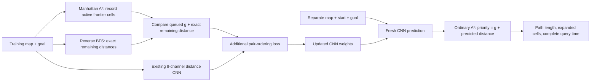

# Learning priorities from the search frontier

This pilot returns to the proposal's main question: can obstacle-aware distance predictions help A* expand fewer cells and finish sooner? The model still receives the map and goal and predicts a distance for every cell. It does not choose between search algorithms. The method-selection experiments remain a separate extension.

## What changes

The earlier route objective compares neighboring cells. This pilot also compares cells that are waiting together in A*'s queue, even when they belong to different branches. A cell near a wall may look promising under Manhattan distance while another branch offers a shorter route around the wall.



During training, each queued cell receives a teacher score: its queued path cost `g` plus its exact remaining distance from reverse BFS. Any cell with the minimum teacher score is acceptable. A sampled comparison places one such cell ahead of a cell with a strictly larger score. Equal scores and unreachable cells are excluded. These labels describe route cost; they do not directly measure the number of expansions needed to finish searching.

We inspect the active queue every four expansions, removing stale entries from consideration. Up to eight informative frontiers per start are retained by reservoir sampling, with at most eight comparisons per frontier and two starts per map. Padding has zero weight. The training code includes `g` in the comparison and sets the predicted goal distance to zero, matching inference. Comparison loss is averaged within each example before averaging the batch.

Learning search decisions from an oracle is an established direction; see [Bhardwaj et al. (2017)](https://proceedings.mlr.press/v78/bhardwaj17a.html), already cited in the proposal. This small fixed-data comparison is not an implementation of their full algorithm or a claim of a new search algorithm. In particular, its traces come from Manhattan search, not repeated rollouts of the updated model. A change in the learned search's visited states is a limitation to investigate if the pilot is promising.

## Matched training

Both branches start from the saved eight-channel, seed-7 CNN. Both reuse the same 128 training maps from the earlier mixed development set: 64 walls and 64 random maps, with random densities balanced between 0.10 and 0.25. One goal per map keeps the pilot small. Another 32 existing validation maps provide diagnostics. These are continued-training data, not newly claimed held-out data.

The control keeps the distance loss and route loss with weight 0.02. The candidate adds pair-ordering loss with weight 0.02. Each branch uses the same shuffled batches, Adam at 0.0002, batch size 16, and exactly 20 epochs: 160 updates per branch. The final checkpoint is retained for both; validation logs do not select different training budgets or checkpoints. The network still has 2,713 parameters. No selector weights are used.

The candidate changes the primary score to `g + predicted distance` during evaluation, just as the direct control does. It is not restricted to Manhattan ties. Predictions can overestimate, so shortest paths are not guaranteed. A reduction in expansions is not sufficient if paths become unacceptably long or inference makes total time worse.

## Development comparison

The policy set consists of the 48 existing 32×32 maps from the two selector development runs: 24 walls and 24 random maps. They are checked against both continuation splits and all development groups recorded in the parent CNN checkpoint, including rotations. They were already inspected in other development experiments, so they are not presented as a final test set.

Each map supplies one independently sampled goal and four starts. Every method receives the same queries, including unreachable cases. Comparisons include Manhattan A*, BFS, Weighted A* at 1.25, 1.5, and 2.0, the frozen direct CNN, the continued control, and the frontier-trained CNN. Three shuffled repetitions give 4,608 timed query executions. Every learned query recomputes features and predictions; model loading and reference BFS labels are outside timing. The existing shared search implementation counts expansions and reconstructs paths consistently.

The report separates random and wall maps and records total time, expansions, reachable-query success, optimal-path frequency, mean and maximum path-length ratios, and termination statuses. Raw paths, counters, and timings are saved, and repeated outcomes must agree. Exact baselines are checked for optimality and Weighted A* for its configured path bound. Failures are retained and prevent interpreting lower work as a successful improvement.

The first decision is whether the frontier objective improves the wall-map search versus the matched control without an unacceptable path-length or runtime tradeoff. We will inspect the full comparison rather than promote a lower loss as a win. Before a final claim, a promising candidate needs additional seeds, a matched no-obstacle control, and new test maps with settings frozen in advance. The current wall/random comparison alone does not establish which input features the network actually uses.

## Run in PyCharm

Run from the project folder, waiting for each stage to finish:

```bash
.venv/bin/python scripts/run_frontier_pilot.py prepare
.venv/bin/python scripts/run_frontier_pilot.py train
.venv/bin/python scripts/run_frontier_pilot.py evaluate
```

Outputs are saved under `outputs/frontier_pilot`. The training stage prints diagnostics for both branches; evaluation prints the search comparison and saves `summary.json` plus compressed raw evidence. Existing runs and model files are not overwritten. Keep the source and configuration unchanged between stages. The full pilot is left for local execution; only small correctness and command checks have run so far.
