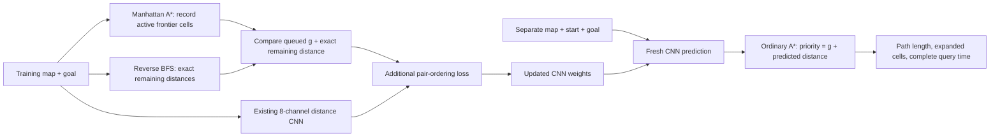

# Learning priorities from the search frontier

This pilot returns to the proposal's main question: can obstacle-aware distance predictions help A* expand fewer cells and finish sooner? The model still receives the map and goal and predicts a distance for every cell. It does not choose between search algorithms. The method-selection experiments remain a separate extension.

## What changes

The earlier route objective compares neighboring cells. This pilot also compares cells that are waiting together in A*'s queue, even when they belong to different branches. A cell near a wall may look promising under Manhattan distance while another branch offers a shorter route around the wall.



During training, each queued cell receives a teacher score: its queued path cost `g` plus its exact remaining distance from reverse BFS. Any cell with the minimum teacher score is acceptable. A sampled comparison places one such cell ahead of a cell with a strictly larger score. Equal scores and unreachable cells are excluded. These labels describe route cost; they do not directly measure the number of expansions needed to finish searching.

We inspect the active queue every four expansions, removing stale entries from consideration. Up to eight informative frontiers per start are retained by reservoir sampling, with at most eight comparisons per frontier and two starts per map. Padding has zero weight. The training code includes `g` in the comparison and sets the predicted goal distance to zero, matching inference. Comparison loss is averaged within each example before averaging the batch.

Learning search decisions from an oracle is an established direction; see [Bhardwaj et al. (2017)](https://proceedings.mlr.press/v78/bhardwaj17a.html), already cited in the proposal. This small fixed-data comparison is not an implementation of their full algorithm or a claim of a new search algorithm. In particular, its traces come from Manhattan search, not repeated rollouts of the updated model. A change in the learned search's visited states is a limitation to investigate if the pilot is promising.

## Matched training

Both branches start from the saved eight-channel, seed-7 CNN. Both reuse the same 128 training maps from the earlier mixed development set: 64 walls and 64 random maps, with random densities balanced between 0.10 and 0.25. One goal per map keeps the pilot small. Another 32 existing validation maps provide diagnostics. These are continued-training data, not newly claimed held-out data.

The control keeps the distance loss and route loss with weight 0.02. The candidate adds pair-ordering loss with weight 0.02. Each branch uses the same shuffled batches, Adam at 0.0002, batch size 16, and exactly 20 epochs: 160 updates per branch. The final checkpoint is retained for both; validation logs do not select different training budgets or checkpoints. The network still has 2,713 parameters. No selector weights are used.

The candidate changes the primary score to `g + predicted distance` during evaluation, just as the direct control does. It is not restricted to Manhattan ties. Predictions can overestimate, so shortest paths are not guaranteed. A reduction in expansions is not sufficient if paths become unacceptably long or inference makes total time worse.

## Development comparison

The policy set consists of the 48 existing 32×32 maps from the two selector development runs: 24 walls and 24 random maps. They are checked against both continuation splits and all development groups recorded in the parent CNN checkpoint, including rotations. They were already inspected in other development experiments, so they are not presented as a final test set.

Each map supplies one independently sampled goal and four starts. Every method receives the same queries, including unreachable cases. Comparisons include Manhattan A*, BFS, Weighted A* at 1.25, 1.5, and 2.0, the frozen direct CNN, the continued control, and the frontier-trained CNN. Three shuffled repetitions give 4,608 timed query executions. Every learned query recomputes features and predictions; model loading and reference BFS labels are outside timing. The existing shared search implementation counts expansions and reconstructs paths consistently.

The report separates random and wall maps and records total time, expansions, reachable-query success, optimal-path frequency, mean and maximum path-length ratios, and termination statuses. Raw paths, counters, and timings are saved, and repeated outcomes must agree. Exact baselines are checked for optimality and Weighted A* for its configured path bound. Failures are retained and prevent interpreting lower work as a successful improvement.

The first decision is whether the frontier objective improves the wall-map search versus the matched control without an unacceptable path-length or runtime tradeoff. We will inspect the full comparison rather than promote a lower loss as a win. Before a final claim, a promising candidate needs additional seeds, a matched no-obstacle control, and new test maps with settings frozen in advance. The current wall/random comparison alone does not establish which input features the network actually uses.

## Run in PyCharm

Run from the project folder, waiting for each stage to finish:

```bash
.venv/bin/python scripts/run_frontier_pilot.py prepare
.venv/bin/python scripts/run_frontier_pilot.py train
.venv/bin/python scripts/run_frontier_pilot.py evaluate
```

Outputs are saved under `outputs/frontier_pilot`. The training stage prints diagnostics for both branches; evaluation prints the search comparison and saves `summary.json` plus compressed raw evidence. Existing runs and model files are not overwritten. Keep the source and configuration unchanged between stages.

## Broader training data at the same update budget

The first local pilot completed. On wall maps, the frontier model expanded 161.5 cells per query compared with 161.0 for the continued control and 210.9 for Manhattan. Total times were 1.166, 1.175, and 0.664 ms respectively. The added objective did not establish an improvement over the matched control. For wall-map comparisons, frontier ordering accuracy increased from 86.5% to 89.9% on the training data, while validation accuracy changed from 82.1% to 81.9%. This motivates checking whether broader continuation data helps; it does not prove that dataset size caused the result.

The next configuration expands the subset from 64 to 256 wall maps and from 64 to 256 random maps. Random maps increase too, so the wall/random balance stays at 50/50 and both random densities remain equally represented. This tests diversity of the mixed continuation set, not the isolated effect of adding wall maps alone. All added maps come from the existing training split, and the parent CNN has already seen that development set. They are additional continuation examples, not a new map generator or unseen wall distribution.

| Setting | First pilot | Diversity pilot |
| --- | ---: | ---: |
| Training maps | 128 | 512 |
| Maps with walls | 64 | 256 |
| Epochs | 20 | 5 |
| Batch size | 16 | 16 |
| Updates per branch | 160 | 160 |
| Map-goal examples processed per branch | 2,560 | 2,560 |

Both branches restart from the same original eight-channel checkpoint, not from the first pilot's continued weights. Network size, learning rate, objectives, trace sampling, seed, 32 validation maps, 48 policy maps, and policy endpoints stay unchanged. The larger subset contains every map in the smaller subset. More unique examples replace repeated exposure to the same examples; equal update counts do not imply equal preparation time or total wall-clock time.

Run these commands in order:

```bash
.venv/bin/python scripts/run_frontier_pilot.py prepare --config configs/frontier_diversity.toml --run outputs/frontier_diversity
.venv/bin/python scripts/run_frontier_pilot.py train --run outputs/frontier_diversity
.venv/bin/python scripts/run_frontier_pilot.py evaluate --run outputs/frontier_diversity
```

Results are saved separately under `outputs/frontier_diversity`. Compare the new frontier model with its new control first, then examine changes from the earlier run. Timing comparisons across runs should also consider their remeasured baselines because machine load can change. Expansions, path quality, and reachable-query success remain separate outcomes. This completed run is another development check, not a final test.

## Profile the frozen model before further changes

The broader local run completed. Its frontier model returned optimal paths on all 96 wall queries and expanded 166.4 cells on average versus Manhattan's 210.9. Mean complete-query time was 0.663 ms versus 0.360 ms. This is an observed development result, not an optimality guarantee. The next step measures where the time goes without training again.

```bash
.venv/bin/python scripts/profile_frontier.py
```

This command uses the saved frontier model in `outputs/frontier_diversity` and the same 48 maps and 192 queries. It measures Manhattan, the unchanged learned-search function, and an instrumented copy of the learned wrapper in shuffled order for five repetitions: 2,880 timed executions. All methods use external call boundaries and one CPU thread. Model loading, warm-up, map-file reads, reference BFS labels, correctness checks, and evidence writing are outside query timing. Every learned execution rebuilds the input and runs the CNN.

The instrumented wrapper retains the existing network operations and shared A* search loop. It separates occupancy/input encoding, the CNN forward pass, output conversion and checks, and search including path reconstruction. Remaining wrapper and timer costs are reported as `other`. Tests and the run itself compare complete paths, costs, statuses, and all search counters with the unchanged implementation. The profile also handles no-path cases; incomplete queries stop the diagnostic rather than silently disappearing from its averages.

For each query and method, the report retains the repetition with median total time and all components from that same repetition. Components therefore add to the reported total; they are not independently selected component medians. Queries are averaged within maps, then maps within each family. `profile_over_reference_map_ratio` and its whole-map bootstrap interval show whether instrumentation measurably changes runtime. Component percentages are approximate diagnostic allocations, not untouched production timings or pure hardware kernel timings.

`remaining_time_budget_ms` is Manhattan's mean total time minus the profiled learned search time. It estimates the budget available for all non-search work if that search time stays fixed. A negative value means even that measured search portion exceeds Manhattan's total; it is not an error or a promise that removing one component would achieve the calculated saving. The two other useful outputs are the uninstrumented learned/Manhattan ratio and the search-only/Manhattan ratio.

Results and raw repetitions are saved separately in `outputs/frontier_profile`. The command refuses to overwrite an existing output or accept a changed checkpoint.

## Completed runtime profile

The local profile completed all 2,880 timed executions on the same 48 development maps without retraining. The instrumented and unchanged learned functions returned identical paths and search counters. Saved input fingerprints, the raw checksum, and the recomputed timing summaries were verified after the run.

| Mean time per query (ms) | Random maps | Wall maps |
| --- | ---: | ---: |
| Manhattan, complete query | 0.1257 | 0.3459 |
| Learned, unchanged complete query | 0.5230 | 0.6296 |
| Learned, profiled complete query | 0.5256 | 0.6321 |
| Input preparation | 0.0236 | 0.0233 |
| CNN forward pass | 0.3017 | 0.2965 |
| Output processing | 0.0070 | 0.0072 |
| Search and path reconstruction | 0.1847 | 0.2963 |
| Other overhead | 0.0086 | 0.0087 |

The mean map-paired profiled/reference ratios were 1.006 for random maps and 1.004 for walls. Their 95% whole-map bootstrap intervals were [0.993, 1.018] and [0.996, 1.012]. These results show little measured instrumentation overhead, although the component times remain diagnostic estimates.

On walls, the learned search portion took 14.3% less time than Manhattan's complete query, but the unchanged learned method was still 1.82 times slower overall. The measured search saving leaves only 0.0495 ms for all non-search work. If input preparation, output processing, and other costs stay fixed, the CNN would have about 0.0103 ms available instead of 0.2965 ms: roughly a 28.9-fold forward-pass speedup just to match Manhattan. This is a conditional budget calculation, not a prediction that such a speedup is achievable. Reducing CNN time alone to 0.0495 ms would not be enough.

On random maps, the search portion alone was 1.47 times Manhattan's complete time; the unchanged learned method was 4.16 times slower overall. Removing neural overhead alone would therefore not close that gap under the measured search behavior.

These findings separate two problems: inference cost on walls and search effort as well as inference cost on random maps. Another training run should target a specific search-quality weakness rather than be presented as a runtime fix. Before spending more training time, a useful next diagnostic is to inspect wall queries with the largest expansion regressions and compare their learned distances and frontier choices with BFS labels. All current results remain development evidence; a stronger general claim still needs frozen settings and fresh test maps.

The model SHA-256 is `828a44d35fc4b0f40e413547762b5433c7d0e60d35aa084719656acf7eaf1e59`; the compressed raw-evidence SHA-256 is `f755b03e7f504305e9be979e8d161e09fdb2ab7261e6b8da61acc073e002846d`.

## Inspect wall-map regressions

```bash
.venv/bin/python scripts/diagnose_frontier.py
```

This command ranks the existing wall queries by learned expansions minus Manhattan expansions. It reports how many improved, tied, or regressed, then inspects up to five positive regressions from different maps. It verifies saved fingerprints, repeated outcomes, and raw checksums before replaying the selected learned searches against their saved paths and counters. No training or new timing comparison is performed.

For each selected case, BFS supplies exact distances. The diagnostic reports prediction errors for reachable cells, separating cells that require a detour beyond Manhattan distance. It also checks neighboring predictions: on a unit-cost edge, a consistent heuristic should satisfy `h(u) <= 1 + h(v)`. These checks identify possible weaknesses; they do not prove why a particular expansion occurred. Errors along the returned path are not a trace of frontier decisions.

Outputs go to `outputs/frontier_diagnosis`: `summary.json`, the full wall-query `ranking.json`, and per-case error records, prediction/label arrays, and text maps showing both returned paths. Existing outputs are not overwritten. Send the printed summary first. These deliberately selected failures are development diagnostics, not representative performance estimates or a final test.

## Consistency training pilot

The completed wall diagnostic found fewer expansions in 62 of 96 queries, equal expansions in five, and more expansions in 29. In the five selected failures, about 30–34% of directed reachable edges violated the consistency inequality. The worst selected query included 151 repeated expansions. This motivates a controlled training check, but the selected cases alone do not establish that inconsistency caused the regressions.

Both new branches start from the completed diversity pilot's frontier checkpoint. They reuse all 512 continuation maps, the same 32 diagnostic validation maps, and the same 48 policy maps and endpoints. The five inspected failures are not added to training. Each branch runs five epochs with batch size 16, Adam at 0.0002, seed 7, and the same shuffled batch order: 160 updates per branch. Both retain the final epoch; no checkpoint is selected using the policy results.

The control keeps distance loss, route loss weighted by 0.02, and frontier loss weighted by 0.02. The candidate adds consistency loss weighted by 0.02. Predictions are converted back to grid steps and the goal prediction is set to zero, matching search. For each horizontal or vertical edge between reachable free cells, the penalty is `max(0, abs(h(u) - h(v)) - 1)^2`. Edges are counted once, averaged within each map, then averaged across the batch. Blocked and unreachable cells are excluded. The weight is a fixed pilot choice, not a tuned optimum.

This penalty encourages adjacent predictions to agree with a one-step move; it does not guarantee consistency on new maps or optimal returned paths. A low penalty alone is insufficient: a constant zero heuristic is consistent but provides little search guidance. Keeping the other objectives and measuring actual search behavior addresses this tradeoff. Network size and inference operations are unchanged, so the experiment targets search effort rather than directly reducing CNN computation.

Run each stage after the previous one finishes:

```bash
.venv/bin/python scripts/run_consistency_pilot.py prepare
.venv/bin/python scripts/run_consistency_pilot.py train
.venv/bin/python scripts/run_consistency_pilot.py evaluate
```

The new directory is `outputs/consistency_pilot`; existing runs are preserved. Preparation checks the parent checkpoint and source fingerprints. Evaluation compares Manhattan, Weighted A* at 1.5, the frozen parent, the continued control, and the consistency candidate on all 192 queries. Three shuffled repetitions give 2,880 timed executions. Timing uses external call boundaries with fresh input preparation and CNN inference for every learned query. Loading, warm-up, BFS labels, path checks, and evidence writing are excluded. Incomplete queries stop the evaluation instead of being counted as a speedup.

The printed summary separates walls and random maps and reports total time, expansions, repeated expansions, and path quality. Candidate-minus-control differences use per-map averages and 95% whole-map bootstrap intervals; negative differences favor the candidate. These intervals describe variation across the current maps, not training-seed uncertainty. Path ratios exclude zero-length queries, while optimal-path fractions include them. Raw paths and all search counters are saved and checked across repetitions.

The next decision uses the candidate versus its matched control: did repeated expansions and total expansions decrease without worse path quality, and did that affect complete-query time? A lower validation penalty without a search improvement is not a successful result. This remains a one-seed development pilot, with additional seeds and fresh maps reserved for a promising result.

### Completed consistency result and one lower-weight check

The local run completed all 2,880 timed executions. Saved fingerprints, model hashes, raw checksum, repeated outcomes, and recomputed summaries were verified. Validation consistency loss fell from the control's 1.7210 to 0.6421, but distance loss increased from 0.01103 to 0.01276 and route loss from 0.2187 to 0.2492.

| Wall-query mean | Frozen parent | Continued control | Consistency candidate |
| --- | ---: | ---: | ---: |
| Complete time (ms) | 0.6360 | 0.6327 | 0.6692 |
| Expansions | 166.42 | 166.10 | 196.01 |
| Repeated expansions | 6.05 | 6.59 | 1.86 |
| Optimal returned paths | 96/96 | 93/96 | 96/96 |

On walls, the candidate reduced repeated expansions by 71.7% versus its control but increased total expansions by 18.0% and time by 5.8%. It expanded 34.64 more distinct cells per query on average. The paired time difference was +0.0365 ms, with a whole-map 95% bootstrap interval of [+0.0191, +0.0543]. The frozen parent also retained 96/96 optimal paths with fewer expansions and lower mean time, so the candidate did not improve the main wall-search result.

On random maps, expansions fell by 17.5% and time by 6.3% versus the control, but optimal paths fell from 90/91 to 89/91. Mean time remained 0.4842 ms versus Manhattan's 0.1293 ms. These are development observations from one training seed; the wall and random tradeoffs should remain separate.

A single follow-up lowers only the consistency weight from 0.02 to 0.002. Both branches restart from the same frozen diversity checkpoint, not from the newly trained candidate. Data, batch order, 160-update budgets, final-epoch selection, and evaluation stay unchanged. The hypothesis is that a lighter penalty may reduce repeated expansions while preserving useful distance differences. This weight is a bounded follow-up choice, not an established optimum. If it also fails against its matched control on wall search, retain the frozen parent and stop this weight check before expanding to more seeds.

```bash
.venv/bin/python scripts/run_consistency_pilot.py prepare --config configs/consistency_light.toml --run outputs/consistency_light
.venv/bin/python scripts/run_consistency_pilot.py train --run outputs/consistency_light
.venv/bin/python scripts/run_consistency_pilot.py evaluate --run outputs/consistency_light
```

The original run remains unchanged in `outputs/consistency_pilot`. Repeated use of these policy maps makes the follow-up development evidence, not a fresh final test.

### Lower-weight result and decision

The 0.002 run completed all 2,880 timed executions. Source fingerprints, checkpoint hashes, the raw checksum, repetition coverage, stable outcomes, and recomputed summaries passed verification. The two runs' control models have identical parameter tensors; their checkpoint file hashes differ because the saved training configurations differ.

| Wall-query mean, same measurement run | Frozen parent | Continued control | Weight 0.002 |
| --- | ---: | ---: | ---: |
| Complete time (ms) | 0.6631 | 0.6621 | 0.6633 |
| Expansions | 166.42 | 166.10 | 171.33 |
| Repeated expansions | 6.05 | 6.59 | 4.88 |
| Optimal returned paths | 96/96 | 93/96 | 96/96 |

Relative to the matched control, wall repeated expansions decreased by 26.1%, but total expansions increased by 3.15%. The paired expansion difference was +5.23, with a 95% whole-map bootstrap interval of [+1.96, +8.49]. The time difference was +0.0012 ms, with an interval of [-0.0118, +0.0131], so this run does not establish a runtime improvement. The frozen parent returned the same number of optimal wall paths with fewer expansions. Neither model has a general optimality guarantee.

On random maps, the candidate reduced expansions by 6.42% and mean time by 2.06% versus the control. Optimal paths remained 89/91 for the candidate versus 90/91 for the control. Validation consistency loss decreased to 1.3278 from 1.7210, but the lower penalty did not produce a wall-search improvement.

Stop this consistency-weight check as planned and retain the frozen diversity checkpoint as the current wall-search candidate. This does not rule out every possible consistency objective; it records the outcome of these two bounded settings. The useful finding is that reducing repeated expansions alone did not reduce total search effort here. The next proposed step is a separate evaluation with settings frozen and previously unused maps, rather than selecting another weight using the same policy cases. The broader claim remains limited: the current candidate reduced wall expansions on the development set but did not beat Manhattan in complete-query time.

## Frozen-model test on new maps

The next run fixes the diversity frontier checkpoint, search settings, map counts, and random seeds before generating test maps. No model is trained or selected in this run. Its main comparison is learned versus Manhattan expansions on 32×32 wall maps, considered alongside path quality and complete-query time. Random maps and the 64×64 size check are reported separately. This evaluates one selected training seed; it does not measure variation across training seeds or establish that the obstacle input alone caused an improvement.

The test contains 30 maps for each of random-32, walls-32, random-64, and walls-64: 120 maps total. Each random family contains 15 maps at obstacle density 0.10 and 15 at 0.25. Generation uses the existing random and wall generators, so these are new layouts from familiar families, not new obstacle types. All 7,016 earlier layout groups are excluded, including rotations. Four starts and one goal are sampled independently of reachability on each map, giving 480 queries. Unreachable queries are retained.

Manhattan A*, Weighted A* at 1.5, ordinary per-query BFS, and the frozen learned A* receive identical queries. Five shuffled repetitions produce 9,600 timed executions. Every learned query rebuilds features and runs the CNN; neither predictions nor BFS policies are cached between queries. External call timing includes search and path reconstruction. Model loading, warm-up, map loading, reference BFS labels, checks, and output writing are outside timing. This measures resident-model query time, not application startup.

The runner checks saved paths against the map and BFS costs, verifies exact-baseline optimality and the weighted bound, and requires repeated outcomes and counters to agree. Incomplete queries stop the run with partial evidence retained; they cannot become apparent speedups. For each query, the median-total repetition supplies the measurements. Family means average queries within maps and then maps equally. Learned-minus-Manhattan differences have whole-map bootstrap intervals; negative values favor the learned method. These intervals concern sampled maps, not all possible layouts or model seeds.

Run each command after the previous one succeeds:

```bash
.venv/bin/python scripts/run_frontier_fresh_test.py prepare
.venv/bin/python scripts/run_frontier_fresh_test.py evaluate
.venv/bin/python scripts/run_frontier_fresh_test.py verify
```

Outputs are stored in `outputs/frontier_fresh_test`, including the frozen model copy, protocol, map manifest, exclusion list, environment details, full raw outcomes, and `summary.json`. Existing outputs are not overwritten. The verification command regenerates maps and endpoints from their seeds, checks exclusions and evidence hashes, validates every saved path and repetition, and recomputes the summary without inference or new timing. Send the evaluation summary and verification output. Once inspected, these maps must not be reused to tune the method while still being described as an untouched test.

### Completed fresh-map result

All 120 maps and 9,600 timed executions completed. Verification regenerated the layouts and endpoints, checked separation and hashes, validated every saved path, and recomputed the summary. The fixed model returned a path for all 478 reachable queries and correctly reported the two unreachable queries. No training or model selection used these results.

| Family | Manhattan / learned expansions | Expansion change | Manhattan / learned time (ms) | Learned optimal paths |
| --- | ---: | ---: | ---: | ---: |
| Random 32 | 47.66 / 74.51 | +56.3% | 0.0995 / 0.5744 | 119/119 |
| Random 64 | 124.02 / 250.14 | +101.7% | 0.2475 / 1.6399 | 92/119 |
| Walls 32 | 214.43 / 161.12 | -24.9% | 0.3765 / 0.7141 | 116/120 |
| Walls 64 | 965.13 / 717.82 | -25.6% | 1.6086 / 2.5417 | 79/120 |

Percent changes above are ratios of family means. On walls-32, the learned-minus-Manhattan expansion difference was -53.31, with a 95% whole-map bootstrap interval of [-74.00, -34.02]. On walls-64 it was -247.32, with an interval of [-354.63, -155.96]. Both support fewer expansions on these sampled wall families. Complete time was nevertheless 1.90 and 1.58 times Manhattan's time, respectively; both paired time intervals were positive. Random-map expansion and runtime comparisons favored Manhattan at both sizes.

The wall expansion reduction comes with a path-quality tradeoff: mean excess path length was 0.145% on walls-32 and 1.129% on walls-64, with worst cases of 7.41% and 12.24%. In particular, the earlier 96/96 optimal wall development paths did not establish a guarantee: the fresh wall sets returned 116/120 and 79/120 optimal paths. The reduced optimal-path frequency at size 64 limits the transfer claim even though expansions decreased. These comparisons do not establish equal-quality efficiency gains.

All three classical controls had lower mean runtime than the learned method in every family. Weighted A* used fewer expansions on random maps, with lower optimal-path frequency than the learned model. Ordinary BFS used more expansions but remained faster here; this reinforces the need to distinguish expanded cells from total time. This is a per-query BFS comparison, not the earlier reused reverse-BFS policy.

Retain this completed test as evidence and do not tune against it. The supported conclusion is narrower than an overall speedup: the selected CNN reduced expansions on fresh wall layouts, while inference cost, weaker random-map behavior, and reduced path quality at larger sizes prevented it from outperforming the classical controls overall. This one-seed experiment does not isolate the causal contribution of obstacle inputs or establish behavior on new wall generators.

The raw-evidence SHA-256 is `ebc6bd38fa6138ae5e196b6463c98605c3ff03e5d4a070f32ac90d9a8f8a5484`; the model remains `828a44d35fc4b0f40e413547762b5433c7d0e60d35aa084719656acf7eaf1e59`.
