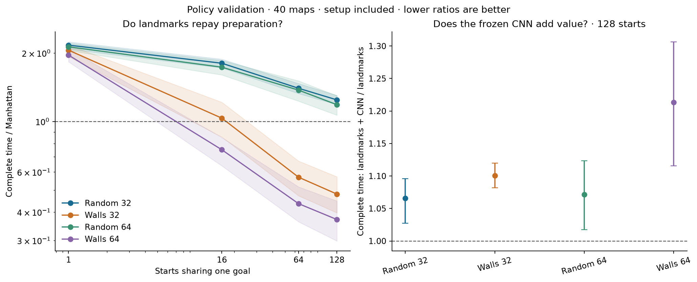

# Step 2: complete-time landmark results

This is the [fixed validation pilot](landmark_timing.md): 40 existing maps, one frozen 8-channel model seed, four session sizes, and seven repetitions. No training or fresh-test selection took place. All methods returned optimal costs and correct reachability.

Landmark-only search wins on the measured wall families once enough starts share a goal, but loses on the random families. The frozen CNN makes landmarks slower in all four 128-start comparisons. Reverse BFS has the lowest mean 128-start time in every family. The improvement over Manhattan therefore belongs to the classical landmark estimate, not the model.

## Complete time

Values are mean milliseconds per query after taking each map's median session. All map/goal setup is charged once per session, including the four landmark BFS runs and CNN prediction when used. Lower is better.

### 1 start(s) sharing one goal

| Method | Random 32 | Walls 32 | Random 64 | Walls 64 |
| --- | ---: | ---: | ---: | ---: |
| Manhattan | 1.4120 | 1.5302 | 5.6348 | 6.5000 |
| Manhattan + CNN | 2.3024 | 2.4440 | 8.6283 | 9.4769 |
| Landmarks | 3.0607 | 3.1192 | 12.0326 | 12.5439 |
| Landmarks + CNN | 3.9453 | 4.0293 | 15.1380 | 15.5479 |
| BFS policy | 1.4437 | 1.4578 | 5.9060 | 5.8934 |

### 128 start(s) sharing one goal

| Method | Random 32 | Walls 32 | Random 64 | Walls 64 |
| --- | ---: | ---: | ---: | ---: |
| Manhattan | 0.0542 | 0.2186 | 0.2401 | 1.2089 |
| Manhattan + CNN | 0.0586 | 0.2219 | 0.2561 | 1.2035 |
| Landmarks | 0.0670 | 0.0947 | 0.2676 | 0.4535 |
| Landmarks + CNN | 0.0711 | 0.1045 | 0.2847 | 0.5190 |
| BFS policy | 0.0135 | 0.0147 | 0.0502 | 0.0544 |

## Does preparation pay off?

These are paired landmark-only / Manhattan time ratios, averaged equally over maps. A value below one favors landmarks. Brackets show pointwise 95% whole-map bootstrap intervals, using 10 maps in each family. An interval crossing one does not establish a win.

| Starts | Random 32 | Walls 32 | Random 64 | Walls 64 |
| --- | ---: | ---: | ---: | ---: |
| 1 | 2.170 [2.085, 2.243] | 2.061 [1.933, 2.172] | 2.133 [2.056, 2.214] | 1.961 [1.833, 2.090] |
| 16 | 1.806 [1.722, 1.882] | 1.035 [0.855, 1.216] | 1.735 [1.604, 1.857] | 0.752 [0.638, 0.851] |
| 64 | 1.401 [1.328, 1.469] | 0.569 [0.472, 0.671] | 1.375 [1.230, 1.511] | 0.435 [0.362, 0.516] |
| 128 | 1.246 [1.187, 1.304] | 0.480 [0.397, 0.572] | 1.187 [1.067, 1.299] | 0.371 [0.298, 0.447] |

## Does the CNN add value?

At 128 starts, compare landmark + CNN directly with landmark-only. This isolates the added prediction cost and tie ordering. Expansion ratios use reachable queries, averaged within each map first; timing includes unreachable queries too.

| Condition | Landmark time / Manhattan | CNN addition: time / landmarks | Landmark expansions / Manhattan | CNN addition: expansions / landmarks |
| --- | ---: | ---: | ---: | ---: |
| Random 32 | 1.246 [1.187, 1.304] | 1.066 [1.027, 1.096] | 0.928 [0.893, 0.960] | 0.973 [0.929, 1.005] |
| Walls 32 | 0.480 [0.397, 0.572] | 1.101 [1.082, 1.120] | 0.468 [0.394, 0.545] | 1.054 [1.020, 1.094] |
| Random 64 | 1.187 [1.067, 1.299] | 1.072 [1.017, 1.123] | 0.865 [0.797, 0.927] | 1.049 [0.964, 1.155] |
| Walls 64 | 0.371 [0.298, 0.447] | 1.214 [1.116, 1.306] | 0.351 [0.304, 0.394] | 1.227 [1.084, 1.362] |

## Where the time goes

The 128-start breakdown below is in milliseconds per query. Each component comes from the same repetition as the median total. Setup includes graph creation, landmark or reverse BFS preparation, prediction, and score/planner construction. Small timer overhead can make setup plus search differ slightly from total.

| Condition | Method | Setup | Of which CNN | Search/path output | Total |
| --- | --- | ---: | ---: | ---: | ---: |
| Random 32 | Manhattan | 0.0104 | 0.0000 | 0.0438 | 0.0542 |
| Random 32 | Manhattan + CNN | 0.0175 | 0.0060 | 0.0411 | 0.0586 |
| Random 32 | Landmarks | 0.0232 | 0.0000 | 0.0438 | 0.0670 |
| Random 32 | Landmarks + CNN | 0.0299 | 0.0058 | 0.0412 | 0.0711 |
| Random 32 | BFS policy | 0.0113 | 0.0000 | 0.0023 | 0.0135 |
| Walls 32 | Manhattan | 0.0104 | 0.0000 | 0.2082 | 0.2186 |
| Walls 32 | Manhattan + CNN | 0.0173 | 0.0058 | 0.2046 | 0.2219 |
| Walls 32 | Landmarks | 0.0237 | 0.0000 | 0.0710 | 0.0947 |
| Walls 32 | Landmarks + CNN | 0.0308 | 0.0061 | 0.0737 | 0.1045 |
| Walls 32 | BFS policy | 0.0112 | 0.0000 | 0.0035 | 0.0147 |
| Random 64 | Manhattan | 0.0422 | 0.0000 | 0.1979 | 0.2401 |
| Random 64 | Manhattan + CNN | 0.0658 | 0.0197 | 0.1903 | 0.2561 |
| Random 64 | Landmarks | 0.0922 | 0.0000 | 0.1754 | 0.2676 |
| Random 64 | Landmarks + CNN | 0.1154 | 0.0191 | 0.1693 | 0.2847 |
| Random 64 | BFS policy | 0.0459 | 0.0000 | 0.0043 | 0.0502 |
| Walls 64 | Manhattan | 0.0427 | 0.0000 | 1.1661 | 1.2089 |
| Walls 64 | Manhattan + CNN | 0.0656 | 0.0200 | 1.1379 | 1.2035 |
| Walls 64 | Landmarks | 0.0954 | 0.0000 | 0.3581 | 0.4535 |
| Walls 64 | Landmarks + CNN | 0.1191 | 0.0201 | 0.3999 | 0.5190 |
| Walls 64 | BFS policy | 0.0454 | 0.0000 | 0.0090 | 0.0544 |

## Scope and retained evidence

The run completed 5,600 sessions and 292,600 query executions in 120.8 seconds of measurement-stage wall time, including checks and writing evidence. This wall time is not a method latency.

Loading the model weights once took 16.11 ms. This is separate from session time, which assumes resident weights. For a first session in an initialized process, add that load cost to the session total, or divide it by the number of starts before adding it to the per-query value. This single load observation is not a cold-start benchmark; Python/library startup and disk-cache conditions were not controlled. Dataset loading, warmup, result verification, and saving are outside all method timers.

All full paths were checked against recomputed BFS labels. Saved paths and counters reconstruct every session signature, including shorter query prefixes and all seven repetitions. Source, model, map-array, and raw-file hashes were checked. Unreachable counts, all timing components, and every batch size are in summary.json.

These are small validation results, not held-out generalization claims. Confidence intervals describe variation over the sampled maps and are not simultaneous intervals for every comparison. Four-landmark selection is fixed, not tuned here. The workload shares a map and goal; it does not establish performance with changing goals or free offline preprocessing.

The 128-start workload contains 5,120 distinct map/start/goal queries. There are 10 unreachable queries in random 32 and six in random 64; all wall queries are reachable. Shorter workloads use prefixes of these same starts. The baseline is the equally prepared Manhattan implementation, so these numbers should not be read as timings for every possible A* implementation. Absolute latencies should be compared within this run, not across earlier rounds.

The first measured batch size with an interval wholly below Manhattan is 64 starts for walls 32 and 16 starts for walls 64. These are sampled workload sizes, not exact break-even thresholds. No such advantage appears for the random families through 128 starts. Ratios are averaged per map; dividing the two overall mean latencies can give a different ratio.

The next research question should address a setting where preprocessing cannot simply solve the shared-goal problem. Reusing one map across changing goals could be examined separately. More training of the current tie model is not justified by this pilot alone. A fresh test and more model seeds would be needed before a general model-performance claim.

The [evidence archive](../results/primary_step2/) retains the protocol, selected maps, source hashes, raw sessions, full query paths, median sessions, and summaries.
