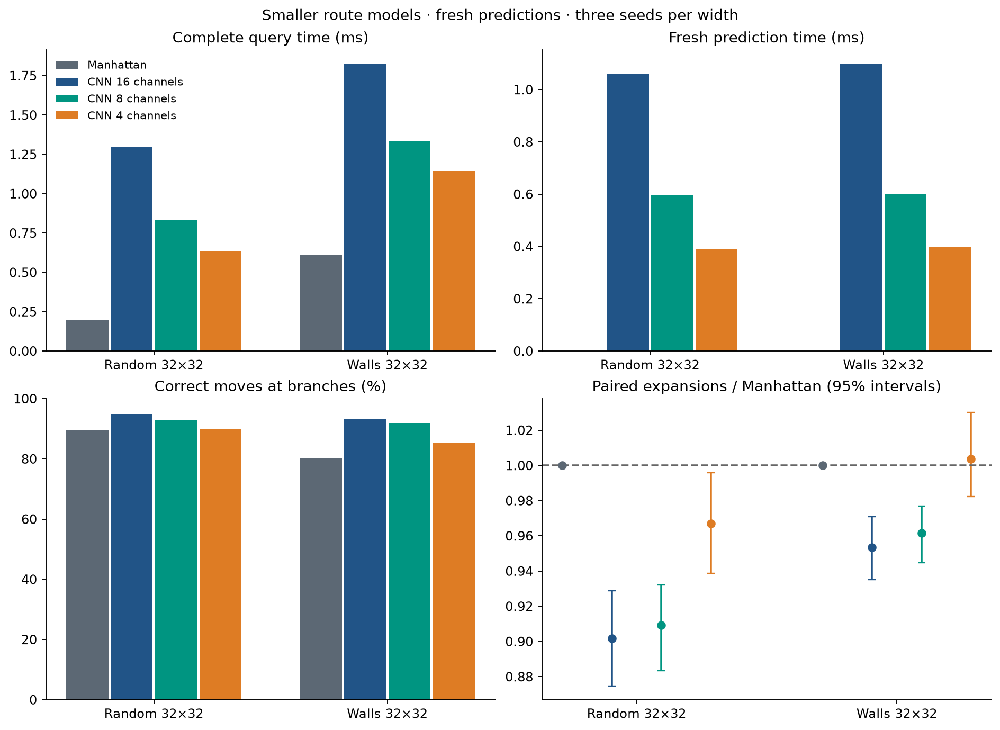

# Smaller-model results

This experiment follows the [fixed width comparison](lightweight_models.md). It changes the CNN from 16 channels to 8 or 4 while keeping the training data, five convolution blocks, receptive field, loss, and search rule unchanged. The existing 16-channel models are remeasured on every new query.

Validation selected **4 channels**. The smaller model passed the fixed speed, search-effort, and path-quality gates.

On random and wall 32×32 test maps, the selected model averaged 0.6359 ms and 1.1451 ms per query. The 16-channel control averaged 1.2990 ms and 1.8222 ms; Manhattan averaged 0.1988 ms and 0.6102 ms. These values include a fresh prediction for every query.

The selected model's test intervals show fewer expansions on random maps and no clear expansion difference on walls, compared with Manhattan. The validation gate used mean ratios below one; it did not require a statistically clear reduction. Selection remains fixed even when a validation advantage does not carry over to test maps.

## Training and validation

Three seeds were used for each width. The six new training runs reused 1,200 training maps and 240 checkpoint-validation maps. Another 120 new maps supplied policy validation; only after selection were 300 fresh test maps generated. Every new layout is separate from all earlier layout groups, including rotations.

| Width | Parameters | New training epochs (seeds 7, 17, 27) | Selected epochs |
| --- | ---: | --- | --- |
| 16 | 10,033 | Existing controls | 60, 56, 59 |
| 8 | 2,713 | 60, 60, 60 | 58, 60, 60 |
| 4 | 781 | 60, 60, 60 | 59, 60, 53 |

| Candidate | Total-time ratio to 16 channels | Expansion ratio: random / walls | Eligible |
| --- | ---: | --- | --- |
| 8 | 0.695 | 0.943 / 0.950 | Yes |
| 4 | 0.546 | 0.984 / 0.999 | Yes |

The selection score pairs the same query and training seed, averages within maps, and gives random and wall groups equal weight. Eligibility requires correct optimal paths, fewer expansions than Manhattan in both groups, and a total-time ratio below one. All three widths remain in the test tables; the test never changes the choice.

## Fresh test

Times include input preparation, a fresh prediction, search, and path reconstruction. Model loading is excluded. Each query uses the median of five shuffled repetitions on one CPU thread; CNN rows average three seeds. Times and raw expansions include unreachable queries. Branch accuracy measures whether the preferred legal neighbor belongs to a shortest route, rather than the search success rate.

### Random 32

| Method | Total ms | Prediction ms | Search ms | Expanded cells | Branch accuracy |
| --- | ---: | ---: | ---: | ---: | ---: |
| Manhattan | 0.1988 | 0.0000 | 0.1988 | 62.3 | 89.5% |
| CNN 16 channels | 1.2990 | 1.0609 | 0.2258 | 58.0 | 94.8% |
| CNN 8 channels | 0.8349 | 0.5956 | 0.2266 | 58.4 | 93.0% |
| CNN 4 channels | 0.6359 | 0.3910 | 0.2320 | 60.1 | 89.8% |

### Walls 32

| Method | Total ms | Prediction ms | Search ms | Expanded cells | Branch accuracy |
| --- | ---: | ---: | ---: | ---: | ---: |
| Manhattan | 0.6102 | 0.0000 | 0.6102 | 204.7 | 80.2% |
| CNN 16 channels | 1.8222 | 1.0966 | 0.7077 | 197.1 | 93.2% |
| CNN 8 channels | 1.3346 | 0.6017 | 0.7149 | 198.0 | 91.9% |
| CNN 4 channels | 1.1451 | 0.3968 | 0.7292 | 202.7 | 85.3% |

Component medians are computed separately and need not sum exactly to the total.

## All held-out conditions

Each row compares the same queries. Ratios average queries and seeds within maps. Brackets are 95% intervals from 2,000 whole-map bootstrap samples. Expansion ratios use reachable queries; runtime ratios include all queries. A ratio below one favors the row's model. Parameter count alone is not a latency measurement.

| Condition | Width | Total time / 16 channels | Expansions / Manhattan | Optimal paths |
| --- | ---: | --- | --- | ---: |
| Random 32 | 16 | 1.000 [1.000, 1.000] | 0.902 [0.875, 0.929] | 100.0% |
| Random 32 | 8 | 0.625 [0.613, 0.640] | 0.909 [0.883, 0.932] | 100.0% |
| Random 32 | 4 | 0.464 [0.447, 0.486] | 0.967 [0.939, 0.996] | 100.0% |
| Walls 32 | 16 | 1.000 [1.000, 1.000] | 0.953 [0.935, 0.971] | 100.0% |
| Walls 32 | 8 | 0.697 [0.681, 0.713] | 0.962 [0.945, 0.977] | 100.0% |
| Walls 32 | 4 | 0.580 [0.557, 0.602] | 1.004 [0.982, 1.030] | 100.0% |
| Dense 32 | 16 | 1.000 [1.000, 1.000] | 0.988 [0.966, 1.010] | 100.0% |
| Dense 32 | 8 | 0.666 [0.653, 0.680] | 1.000 [0.976, 1.032] | 100.0% |
| Dense 32 | 4 | 0.517 [0.498, 0.536] | 1.017 [0.998, 1.040] | 100.0% |
| Random 16 | 16 | 1.000 [1.000, 1.000] | 0.960 [0.948, 0.972] | 100.0% |
| Random 16 | 8 | 0.741 [0.736, 0.747] | 0.981 [0.969, 0.995] | 100.0% |
| Random 16 | 4 | 0.609 [0.601, 0.619] | 1.014 [0.998, 1.029] | 100.0% |
| Random 64 | 16 | 1.000 [1.000, 1.000] | 0.972 [0.932, 1.016] | 100.0% |
| Random 64 | 8 | 0.591 [0.577, 0.607] | 1.023 [0.970, 1.080] | 100.0% |
| Random 64 | 4 | 0.396 [0.376, 0.421] | 1.052 [1.009, 1.101] | 100.0% |

## What changed

The 8-channel model reduced mean total time by 35.7% on random 32×32 maps and 26.8% on walls, relative to the 16-channel control. Its intervals show fewer expansions on random maps and fewer expansions on walls against Manhattan. On 64×64 maps, they show no clear expansion difference.

The 4-channel model reduced mean total time by 51.0% on random 32×32 maps and 37.2% on walls, relative to the 16-channel control. Its intervals show fewer expansions on random maps and no clear expansion difference on walls against Manhattan. On 64×64 maps, they show more expansions.

Every CNN width remained slower than Manhattan on all five test groups. Smaller prediction cost improves the learned method without establishing an overall speed advantage over the classical baseline.

## Scope and retained evidence

This is a width-only experiment with the route objective and Manhattan tie ordering. It does not test fewer convolution blocks, quantization, different training targets, or repeated-query reuse. Absolute times should be compared within this round. The intervals describe maps for three fixed models per width; they do not cover all possible training runs or hardware. All timed methods returned optimal paths and correct reachability, and their counters agreed across repetitions.

Evidence verification checked 84,000 timed runs, all repetitions, shared endpoints, checkpoint hashes, and separated layouts. Independent arithmetic reproduced the paired runtime means. The [archive](../results/research_v5/) retains raw repetitions, summaries, selection, and dataset manifests. The [new models](../artifacts/checkpoints/research_v5/) retain all six checkpoints and training histories.

