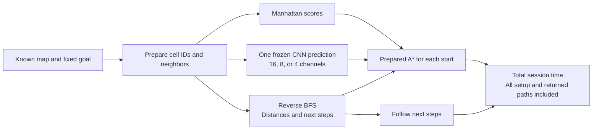

# Smaller models with shared predictions

The smaller-model round lowered prediction cost, but a fresh prediction still made every width slower than Manhattan. This experiment combines those frozen models with the prepared search from the runtime round. It asks whether a cheaper prediction becomes worthwhile when several starts share one map and goal. It does not retrain or select a new model using test results.

## Fixed comparison

Use all nine existing models: 16, 8, and 4 channels, each with seeds 7, 17, and 27. The inputs, learned tie rule, search code, and checkpoints stay unchanged. Include original Manhattan, prepared Manhattan, prepared exact-distance A*, and reverse BFS with stored next steps. Prepared Manhattan is the main runtime baseline because it receives the same search implementation improvements as the learned methods.



Sessions contain 1, 4, 16, 64, or 128 different starts. Smaller sessions use prefixes of the same sampled starts. The primary workload is 64 queries, matching the earlier runtime experiment; 128 queries is an additional workload declared before testing. All methods begin each session without prepared state. Model loading is outside timing, but input encoding, prediction, graph construction, score preparation, BFS preprocessing, search, and path reconstruction are included whenever needed.

## New maps and measurement

Seed 64550 generates 300 new maps: 60 each of random 32×32, wall 32×32, dense 32×32, random 16×16, and random 64×64. Exclude all 5,900 earlier layout groups, including rotations. Keep unreachable starts. BFS labels verify returned paths after timing and are never inputs to the learned methods.

Use one CPU thread, warm-up runs, five repetitions, and shuffled method order. Take the median of each session's repetitions. Average the three model seeds within each map, then compare against that map's prepared Manhattan time. Bootstrap whole maps 2,000 times for pointwise 95% intervals. Report each condition and batch size separately; neither repetitions nor correlated batch sizes count as independent maps. Intervals cover these fixed models and this machine, not variation across newly trained models.

Report complete milliseconds per query, paired time ratios, setup and search time, and reachable-query expansion ratios. Retain per-seed summaries. BFS preprocessing expansions and returned path steps remain separate measurements. A ratio below one suggests a runtime gain; an interval crossing one does not establish one. Since many conditions are compared, any isolated advantage is exploratory and needs confirmation on another fixed test set. The earlier validation selection of 4 channels stays unchanged.

The runner checks checkpoint identities, data separation, paths, optimal costs, reachability, repeated counters, and equality between original and prepared Manhattan. Existing exhaustive small-grid tests cover prepared learned search against its reference implementation. Raw timings and first-repetition query outcomes are streamed to compressed files outside the session timer. Settings, source hashes, and checkpoint hashes are frozen before data generation.

## Reproduction

```sh
python scripts/run_lightweight_reuse.py prepare --run outputs/lightweight_reuse_reproduction
python scripts/run_lightweight_reuse.py evaluate --run outputs/lightweight_reuse_reproduction
python scripts/report_lightweight_reuse.py --run outputs/lightweight_reuse_reproduction --output results/lightweight_reuse_reproduction --report outputs/lightweight_reuse_reproduction.md
python scripts/check_reuse_summary.py --results results/lightweight_reuse_reproduction
```

The source datasets and nine checkpoints listed in `configs/lightweight_reuse.toml` must exist. Use new output directories. Generated map arrays remain local; measurements, manifests, provenance, summaries, and figures are retained.

The final check independently recomputes session medians and paired runtime means from the retained raw measurements using Python's standard library. It does not reuse the report's aggregation functions.
