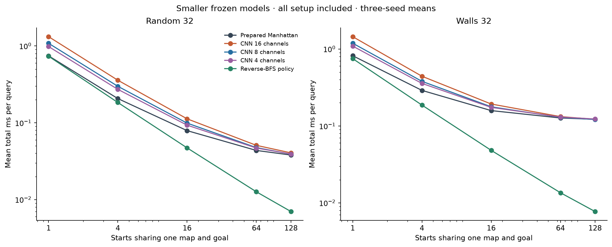
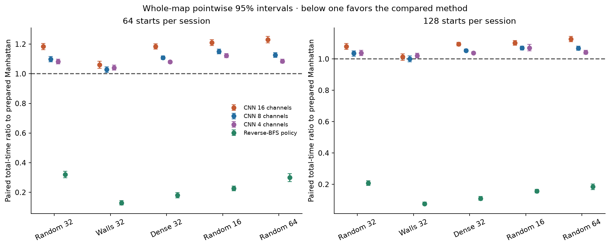

# Smaller models with shared predictions: results

This round follows the [fixed plan](lightweight_reuse.md). It reuses nine existing route-trained checkpoints across 16, 8, and 4 channels. No weights changed and no new model was selected. The 300 new maps exclude all 5,900 earlier layout groups. Each map has one goal and 128 distinct starts; smaller sessions use the same prefixes.

At 64 starts, no learned width has a pointwise interval entirely below prepared Manhattan in any tested condition. At 128 starts, no learned width has a pointwise interval entirely below prepared Manhattan in any tested condition.

Reverse BFS with stored next steps has the lowest mean complete time in 5 of five conditions at 64 starts. The results do not establish a general learned runtime advantage over either prepared Manhattan or this stronger classical control.

The 8-channel model is close to prepared Manhattan on wall maps at 128 starts: its paired ratio is 1.001 [0.981, 1.019]. Its mean time is 0.1213 ms versus 0.1219 ms. The mean of map-wise ratios and the ratio of overall means use different weighting, so they can fall on opposite sides of one. The paired interval does not establish a speedup.

## Complete time per query

Values are milliseconds per query, including all preparation and returned paths. Each session uses the median of five shuffled repetitions on one CPU thread. Learned rows average three seeds within each map, then average maps. Unreachable queries remain included. Model loading is outside timing. Prepared Manhattan is the main baseline because it uses the same search implementation as the models.

### Random 32

| Method | 1 start | 4 starts | 16 starts | 64 starts | 128 starts |
| --- | ---: | ---: | ---: | ---: | ---: |
| Original Manhattan | 0.0980 | 0.1007 | 0.0936 | 0.0902 | 0.0895 |
| Prepared Manhattan | 0.7442 | 0.2068 | 0.0791 | 0.0437 | 0.0380 |
| Prepared exact A* | 0.8339 | 0.2266 | 0.0730 | 0.0333 | 0.0270 |
| Reverse-BFS policy | 0.7357 | 0.1839 | 0.0471 | 0.0126 | 0.0070 |
| CNN 16 channels | 1.3230 | 0.3585 | 0.1127 | 0.0509 | 0.0406 |
| CNN 8 channels | 1.0842 | 0.2988 | 0.0991 | 0.0475 | 0.0391 |
| CNN 4 channels | 0.9836 | 0.2727 | 0.0932 | 0.0469 | 0.0392 |

### Walls 32

| Method | 1 start | 4 starts | 16 starts | 64 starts | 128 starts |
| --- | ---: | ---: | ---: | ---: | ---: |
| Original Manhattan | 0.3790 | 0.3384 | 0.3310 | 0.3355 | 0.3367 |
| Prepared Manhattan | 0.8180 | 0.2898 | 0.1583 | 0.1269 | 0.1219 |
| Prepared exact A* | 0.8608 | 0.2425 | 0.0868 | 0.0485 | 0.0422 |
| Reverse-BFS policy | 0.7500 | 0.1868 | 0.0482 | 0.0136 | 0.0077 |
| CNN 16 channels | 1.4467 | 0.4426 | 0.1928 | 0.1322 | 0.1221 |
| CNN 8 channels | 1.1892 | 0.3801 | 0.1775 | 0.1292 | 0.1213 |
| CNN 4 channels | 1.0916 | 0.3572 | 0.1742 | 0.1304 | 0.1231 |

## Paired comparison with prepared Manhattan

A ratio below one means less complete time. Brackets are pointwise 95% intervals from 2,000 whole-map bootstrap samples. The primary workload is 64 starts; 128 was also fixed before testing. An interval crossing one does not establish an advantage. The grid contains many comparisons, so isolated gains are exploratory and need confirmation. Batch sizes share maps and are not independent samples.

### 64 starts

| Condition | CNN 16 | CNN 8 | CNN 4 | BFS policy |
| --- | ---: | ---: | ---: | ---: |
| Random 32 | 1.184 [1.163, 1.204] | 1.099 [1.081, 1.117] | 1.082 [1.067, 1.099] | 0.320 [0.299, 0.342] |
| Walls 32 | 1.061 [1.036, 1.085] | 1.029 [1.008, 1.047] | 1.041 [1.024, 1.058] | 0.128 [0.114, 0.145] |
| Dense 32 | 1.184 [1.165, 1.203] | 1.109 [1.097, 1.120] | 1.080 [1.071, 1.089] | 0.180 [0.162, 0.199] |
| Random 16 | 1.210 [1.190, 1.230] | 1.150 [1.133, 1.167] | 1.122 [1.108, 1.136] | 0.227 [0.210, 0.242] |
| Random 64 | 1.231 [1.209, 1.252] | 1.127 [1.111, 1.143] | 1.085 [1.072, 1.098] | 0.300 [0.273, 0.325] |

### 128 starts

| Condition | CNN 16 | CNN 8 | CNN 4 | BFS policy |
| --- | ---: | ---: | ---: | ---: |
| Random 32 | 1.079 [1.061, 1.098] | 1.035 [1.018, 1.052] | 1.038 [1.021, 1.056] | 0.208 [0.192, 0.224] |
| Walls 32 | 1.013 [0.991, 1.033] | 1.001 [0.981, 1.019] | 1.021 [1.005, 1.037] | 0.076 [0.068, 0.086] |
| Dense 32 | 1.095 [1.084, 1.106] | 1.054 [1.045, 1.062] | 1.039 [1.032, 1.046] | 0.110 [0.098, 0.123] |
| Random 16 | 1.102 [1.088, 1.117] | 1.070 [1.057, 1.082] | 1.070 [1.052, 1.093] | 0.157 [0.145, 0.168] |
| Random 64 | 1.127 [1.110, 1.144] | 1.068 [1.054, 1.082] | 1.042 [1.030, 1.055] | 0.185 [0.167, 0.202] |

## Setup, search, and search effort

The following table uses the primary 64-start workload. Component medians are computed separately, so setup and search need not sum exactly to total time. Expansion ratios use reachable queries, pair each query with Manhattan, average queries and model seeds within a map, and then average maps. This separates the quality of learned ordering from prediction cost.

| Condition | Method | Setup ms/query | Search ms/query | Reachable expansion ratio |
| --- | --- | ---: | ---: | ---: |
| Random 32 | Prepared Manhattan | 0.0106 | 0.0330 | 1.000 [1.000, 1.000] |
| Random 32 | CNN 16 channels | 0.0203 | 0.0305 | 0.920 [0.901, 0.940] |
| Random 32 | CNN 8 channels | 0.0167 | 0.0308 | 0.941 [0.920, 0.965] |
| Random 32 | CNN 4 channels | 0.0150 | 0.0318 | 0.991 [0.968, 1.017] |
| Random 32 | Reverse-BFS policy | 0.0113 | 0.0013 | See preprocessing counts |
| Walls 32 | Prepared Manhattan | 0.0107 | 0.1161 | 1.000 [1.000, 1.000] |
| Walls 32 | CNN 16 channels | 0.0214 | 0.1108 | 0.951 [0.930, 0.970] |
| Walls 32 | CNN 8 channels | 0.0172 | 0.1120 | 0.958 [0.939, 0.976] |
| Walls 32 | CNN 4 channels | 0.0155 | 0.1148 | 1.015 [0.995, 1.034] |
| Walls 32 | Reverse-BFS policy | 0.0116 | 0.0019 | See preprocessing counts |
| Dense 32 | Prepared Manhattan | 0.0081 | 0.0518 | 1.000 [1.000, 1.000] |
| Dense 32 | CNN 16 channels | 0.0179 | 0.0510 | 0.982 [0.970, 0.994] |
| Dense 32 | CNN 8 channels | 0.0141 | 0.0509 | 0.994 [0.983, 1.003] |
| Dense 32 | CNN 4 channels | 0.0126 | 0.0511 | 1.010 [0.999, 1.023] |
| Dense 32 | Reverse-BFS policy | 0.0078 | 0.0009 | See preprocessing counts |
| Random 16 | Prepared Manhattan | 0.0025 | 0.0151 | 1.000 [1.000, 1.000] |
| Random 16 | CNN 16 channels | 0.0063 | 0.0146 | 0.957 [0.946, 0.967] |
| Random 16 | CNN 8 channels | 0.0052 | 0.0147 | 0.973 [0.962, 0.986] |
| Random 16 | CNN 4 channels | 0.0046 | 0.0148 | 1.000 [0.990, 1.011] |
| Random 16 | Reverse-BFS policy | 0.0026 | 0.0009 | See preprocessing counts |
| Random 64 | Prepared Manhattan | 0.0412 | 0.1583 | 1.000 [1.000, 1.000] |
| Random 64 | CNN 16 channels | 0.0807 | 0.1552 | 1.001 [0.979, 1.025] |
| Random 64 | CNN 8 channels | 0.0641 | 0.1552 | 1.028 [1.001, 1.056] |
| Random 64 | CNN 4 channels | 0.0565 | 0.1564 | 1.059 [1.033, 1.085] |
| Random 64 | Reverse-BFS policy | 0.0443 | 0.0022 | See preprocessing counts |

BFS policy work is not zero: it expands cells once during preprocessing and then follows stored steps for each returned route. Raw session records retain preprocessing expansions, and query records retain path steps.

## What to try next

Smaller predictions and reuse reduce the runtime gap, but the learned search savings remain limited. The 8-channel model retains useful ordering on random and wall 32×32 maps, while both smaller widths expand more cells on 64×64 maps. Repeating the same training for more epochs would not directly lower inference cost or address the missing larger-map training examples.

A focused next experiment should first check how much equal-priority ordering can save using exact labels on existing validation maps. If there is useful room, train one 8-channel pilot with new difficult and larger training layouts, keeping the architecture and inference cost fixed. Use validation search time and optimal paths as the gate before spending time on three seeds and another fresh test set. Keep current test maps out of training and tuning. This is a proposed experiment, not a measured improvement.

## Checks and scope

Verified 97,500 timed sessions containing 4,153,500 query executions. All returned paths had optimal cost and correct reachability; no search limits were reached. Repetitions returned identical paths and counters. Original and prepared Manhattan agreed exactly. The archive verifier checks hashes, complete method coverage, timing repetitions, paired endpoints, and batch prefixes.
An independent standard-library check also recomputed all 19,500 session medians and 3,600 component and paired-ratio means from the raw records.

Reuse requires a static map and unchanged goal. These results do not establish a benefit for changing goals or obstacles. They describe fixed checkpoints on this CPU workload and are not evidence from another training round. The previous validation selection remains 4 channels; all widths are reported without choosing a winner from this test. Per-seed results and all five workloads are in summary.json.

The [evidence archive](../results/research_v6/) retains raw timings, query outcomes, session medians, provenance, summaries, and PNG/PDF figures.
