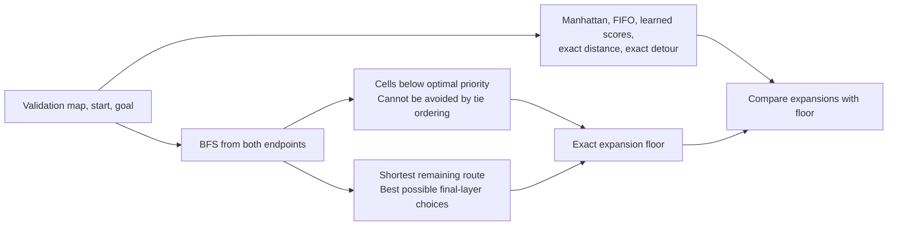

# Ordering limits and a focused training pilot

The reuse experiment brought the 8-channel model close to prepared Manhattan on wall maps. This round first measures the best possible expansion count while keeping Manhattan as the primary priority. It then tests one small training change, with a matched continuation control, before committing resources to more seeds. Earlier test maps remain excluded from training and selection.

## What ordering can and cannot change

For a reachable query, let `C` be the shortest path length, `ds(v)` the exact distance from the start, and `h(v)` Manhattan distance to the goal. Every reachable cell with `ds(v) + h(v) < C` must be expanded. Changing the order of ties cannot avoid these cells. The remaining choice lies among cells with priority equal to `C`. This separation follows the standard final-layer analysis described by [Corrêa, Pereira, and Ritt (2018)](https://ijcai.org/proceedings/2018/655).

For this project's four-way, unit-cost grids, we compute a sharper diagnostic. Let `K` count the mandatory cells above. Among mandatory cells on any shortest route, let `d` be the greatest distance from the start; use `d = -1` if there are none. The minimum expansion count is `K + C - d - 1`. The final term counts the shortest remaining section of a route, excluding the goal because the implementation stops before expanding it. Manhattan is consistent, so priorities cannot decrease along a shortest route.

The diagnostic reaches this floor by favoring cells on a shortest route, then favoring the smallest remaining exact distance. It uses BFS from both endpoints and depends on the start. It is an expansion reference, not a reusable goal-only model or a free practical method. For unreachable queries, ordinary A* must exhaust the start's component. Exhaustive checks cover all 3×3 obstacle layouts and endpoint pairs, and every measured diagnostic query must attain the calculated floor.

## Validation and bounded training

Use 40 existing random 32×32 policy-validation maps, balanced between the two densities, and 40 existing wall maps. Generate another 40 policy-validation maps at 64×64, equally split between random maps and walls. Each map has 128 deterministic distinct starts, with the first 16 used for the expansion audit. Keep unreachable queries. Old test maps are used only for exclusion hashes.

Compare default Manhattan ordering, FIFO, frozen 8- and 16-channel scores for seed 7, learned and exact detour ties, exact-distance ties, the start-aware expansion floor, and exact distances as the primary heuristic. A detour score subtracts Manhattan from predicted distance; shifting the whole field by a constant keeps scores nonnegative without changing their order. Oracle setup is excluded from this count-only diagnostic; it makes no runtime claim. Reachable expansion ratios are averaged within maps. Exact primary distances show the separate benefit available from changing the primary heuristic.

If the attainable floor saves at least 5% relative to Manhattan in any validation family, run the pilot. Start both branches from the same saved 8-channel seed-7 checkpoint. The control continues on the original mixed 32×32 training data. The candidate uses 50% original examples, 25% new wall 32×32 examples, and 25% new random/wall 64×64 examples. Generate 160 new wall 32 maps, 320 mixed 64 training maps, and 80 separate 64 checkpoint-validation maps. Exclude all 6,200 earlier layout groups and every newly generated set from subsequent sets.

Both branches use the same optimizer, learning rate 0.0002, batch size 16, route-loss weight 0.02, and 20 epochs of 48 updates each. Architecture and inference cost stay unchanged. Sampling uses replacement. Four CPU threads are used for training. Select each checkpoint by the equal-weight mean loss on original 32×32 checkpoint validation and new 64×64 checkpoint validation. Neither branch sees policy-validation labels during training. The comparison isolates the data mixture from merely adding more optimizer updates; it does not isolate individual effects of wall and larger-map examples.

## Runtime gate

After freezing both checkpoints, compare original frozen 8-channel, continuation control, and candidate, each with distance and detour ties, against prepared Manhattan, exact A*, and BFS policy on the 120 policy-validation maps. Use 1, 64, and 128 starts, five shuffled repetitions, one CPU thread, and complete session timing including preparation. Oracle diagnostics are kept separate from these practical timings.

The primary workload is 128 starts. Expand training to seeds 17 and 27 only if a candidate rule meets all gates: correct paths; an equal-family mean paired runtime ratio to frozen distance ties at most 0.98 with an upper 95% interval below one; no family runtime regression over 3%; and a wall-32 interval against prepared Manhattan below one. Also require an upper runtime interval below one against the continuation control using the same rule, plus no more than 3% mean expansion regression against frozen distance ties in either 32×32 family. If both rules qualify, use the lower equal-family runtime ratio. Bootstrap whole maps within each family 2,000 times. This is an exploratory validation gate, not a final test claim. If it fails, retain both checkpoints and stop this pilot without extra seeds or a new test run.

Run `python scripts/run_order_pilot.py prepare`, then `headroom`, `train`, and `evaluate`. Settings and source hashes are checked between stages. Generated arrays remain local; raw counts, session timings, query outcomes, training histories, selected checkpoints, and the gate decision are retained for review.
