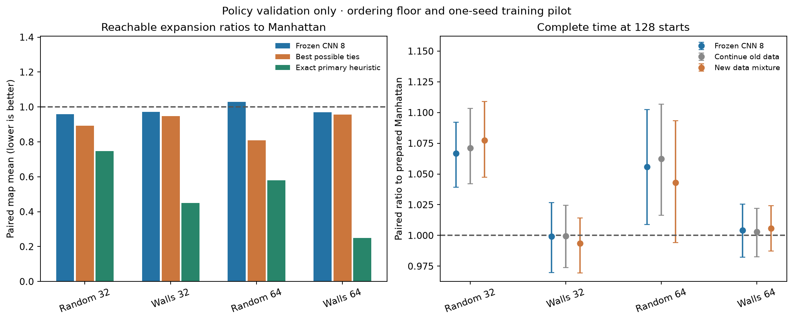

# Ordering limits and training-pilot results

This round follows the [fixed protocol](order_pilot.md). It uses policy validation to measure the expansion limit of Manhattan tie ordering and to assess a small training change. These are exploratory validation results from one model seed, not a new held-out test result.

The new training mixture lowers validation loss, but does not establish a complete-time improvement over the frozen model or matched training control. Neither candidate passes the fixed gate, so the experiment stops before additional seeds or a new test set.

## The ordering limit

The audit checked 1,920 queries on 120 validation maps. The start-aware reference attained the calculated expansion floor on every query. The exact-detour ordering also attained that floor on every measured query. Exhaustive tests separately cover every 3×3 obstacle layout and endpoint pair. The floor applies to this implementation's four-way unit-cost grids with consistent Manhattan primary priorities; it is not a general bound for arbitrary heuristics.

| Condition | Frozen CNN 8 | Perfect distance ties | Best possible ties | Exact primary | Maximum tie saving |
| --- | ---: | ---: | ---: | ---: | ---: |
| Random 32 | 0.958 | 0.898 | 0.893 | 0.746 | 10.7% |
| Walls 32 | 0.971 | 0.947 | 0.947 | 0.450 | 5.3% |
| Random 64 | 1.029 | 0.814 | 0.809 | 0.579 | 19.1% |
| Walls 64 | 0.969 | 0.957 | 0.957 | 0.250 | 4.3% |

Values are map-paired expansion ratios on reachable queries; lower is better. The maximum saving is relative to ordinary Manhattan, not an additional saving on top of the current model. The two BFS-based references use exact information and are count diagnostics, not deployable learned methods or free runtime baselines.

Wall maps leave little room for tie ordering. Most excess work there comes from Manhattan's primary priority, which tie scores cannot change. Exact primary distances reduce expansions much more, showing where a different search design could help. Random 64×64 maps leave more room, but the existing model does not capture that opportunity.

## Testing detour ordering

Subtracting Manhattan from the prediction produces a score for extra travel around obstacles. A constant shift preserves its order while keeping scores nonnegative. This adds no neural-network parameters. It is evaluated separately from ordinary distance ties.

| Condition | Frozen distance ties | Frozen detour ties | Exact detour ties |
| --- | ---: | ---: | ---: |
| Random 32 | 0.958 | 1.732 | 0.893 |
| Walls 32 | 0.971 | 1.107 | 0.947 |
| Random 64 | 1.029 | 1.897 | 0.809 |
| Walls 64 | 0.969 | 1.001 | 0.957 |

The exact score reaches the floor, but the learned score is much less reliable. Prediction errors that were tolerable for distance ties can cause poor ordering after subtracting Manhattan. This experiment does not establish a runtime benefit merely from changing that formula.

## Matched training pilot

Both branches start from the same frozen 8-channel seed-7 model and receive 960 optimizer updates. The control sees only the original training pool. The candidate sees 50% original examples, 25% new wall 32×32 examples, and 25% new mixed 64×64 examples. Both use the same learning rate, loss, and architecture. Checkpoint selection uses a shared mean validation loss across 32×32 and 64×64 maps; policy-validation maps never enter training.

| Branch | Best epoch | Training seconds | Combined validation loss |
| --- | ---: | ---: | ---: |
| Control | 15 | 18.6 | 0.07376 |
| Candidate | 20 | 22.9 | 0.02848 |

Both models still have 2,713 parameters. The candidate lowers the combined distance-and-route validation loss substantially, especially on the larger maps. That improvement must be checked against search effort and complete time; it does not by itself show better search.

## Complete time at 128 starts

All setup is included. Values below are paired ratios to prepared Manhattan, with pointwise whole-map 95% intervals. All methods use the same maps and query prefixes. Five shuffled repetitions supply each session median. Smaller workloads of 1 and 64 starts and all absolute milliseconds are retained in summary.json.

| Method | Random 32 | Walls 32 | Random 64 | Walls 64 |
| --- | ---: | ---: | ---: | ---: |
| prepared manhattan | 1.000 [1.000, 1.000] | 1.000 [1.000, 1.000] | 1.000 [1.000, 1.000] | 1.000 [1.000, 1.000] |
| prepared exact | 0.845 [0.777, 0.903] | 0.391 [0.358, 0.423] | 0.699 [0.597, 0.803] | 0.254 [0.231, 0.277] |
| bfs policy | 0.226 [0.205, 0.245] | 0.079 [0.069, 0.088] | 0.250 [0.207, 0.294] | 0.055 [0.047, 0.064] |
| frozen distance | 1.067 [1.039, 1.092] | 0.999 [0.970, 1.027] | 1.056 [1.009, 1.102] | 1.004 [0.982, 1.025] |
| frozen detour | 1.585 [1.436, 1.754] | 1.027 [1.004, 1.050] | 1.449 [1.302, 1.605] | 1.000 [0.981, 1.017] |
| control distance | 1.071 [1.042, 1.103] | 1.000 [0.974, 1.024] | 1.062 [1.016, 1.107] | 1.003 [0.983, 1.022] |
| control detour | 1.711 [1.535, 1.912] | 1.037 [1.013, 1.062] | 1.521 [1.341, 1.703] | 1.011 [0.994, 1.025] |
| candidate distance | 1.077 [1.047, 1.109] | 0.993 [0.970, 1.014] | 1.043 [0.994, 1.093] | 1.006 [0.987, 1.024] |
| candidate detour | 1.681 [1.505, 1.882] | 1.033 [1.009, 1.059] | 1.941 [1.589, 2.319] | 1.042 [1.020, 1.067] |

## Decision and limitations

Neither candidate rule passed the fixed validation gate. The pilot stops here: no additional seeds were trained and no new test set was consumed. Both checkpoints and all measurements are retained; the prior selected model is unchanged.

| Candidate rule | Mean time / frozen distance ties | Mean time / matched control | Gate passed |
| --- | ---: | ---: | --- |
| distance | 0.999 [0.991, 1.007] | 0.997 [0.988, 1.005] | False |
| detour | 1.378 [1.276, 1.483] | 1.065 [1.036, 1.099] | False |

These overall ratios weight the four map families equally and resample whole maps within each family. The gate also requires a wall-32 speed advantage over prepared Manhattan and limits family-specific regressions. Every individual gate check is recorded in gate.json. A lower distance loss alone does not pass this search-time gate.

The result identifies a boundary for this approach: more accurate tie scores can only recover the small final-layer margin on wall maps. A future method would need to improve the primary search priority or reduce prediction cost further, with an explicit path-quality guarantee or tradeoff. Static repeated-goal workloads should still include reverse BFS as a strong practical control. This round does not claim generalization from one seed or performance on new held-out maps.

## Evidence and checks

The runtime stage completed 16,200 sessions and 1,042,200 query executions. Every method returned optimal costs and correct reachability. Checks verify repeated paths and counters, all expected methods and repetitions, frozen file hashes, original dataset endpoints, query prefixes, and agreement between headroom and runtime queries. The 600 new layouts exclude all 6,200 earlier layout groups and are separated between training, checkpoint validation, and policy validation.

The [archive](../results/research_v7/) contains raw diagnostic counts, runtime repetitions, query outcomes, protocol, data manifests, source hashes, summaries, and the gate decision. Both trained checkpoints and histories are retained in artifacts/checkpoints/research_v7/.
