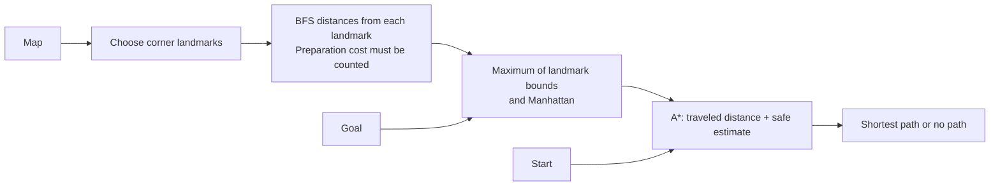

# Step 1: a stronger primary estimate with optimal paths

The goal is to reduce complete query time while keeping shortest paths. The previous experiment changed only the order of equal Manhattan priorities. This step checks a stronger primary estimate before adding another learned component. It uses no training and consumes no validation or test maps.

## Method and guarantee

A* gives each cell priority `distance already traveled + estimated distance remaining`. Manhattan supplies the second term cheaply, but ignores detours around obstacles. A model can estimate those detours, but an overestimate can make A* stop with a longer path. Mixing a prediction with Manhattan does not remove that risk.

For a safe control, choose up to four landmark cells near the map corners. Choose them using only the map, before receiving a start or goal. A blocked corner uses the closest free cell by Manhattan distance, with row and column breaking ties; duplicate choices are removed. Run BFS from each landmark and store its exact distances.

For an undirected grid, `abs(distance(L, cell) - distance(L, goal))` is a lower bound on the remaining distance. We take the largest available landmark bound and Manhattan. This follows the landmark approach of [Goldberg and Harrelson (2005)](https://www.microsoft.com/en-us/research/wp-content/uploads/2005/01/soda05.pdf). It is an existing classical method, not a new learned contribution.

Each bound stays below the true distance and changes by at most one across a free edge. Their maximum preserves both properties and is zero at the goal. Therefore the existing A* search still returns shortest paths on four-way, unit-cost grids. Pairs with unreachable landmark distances are ignored; `-1` is never treated as a distance. A component without a usable landmark falls back to Manhattan. Rebuild the index when the map changes.



## Small illustrations

These three hand-built cases explain behavior. They are not evidence of generalization or runtime superiority. Search expansions exclude popping the goal, as in the earlier experiments. Preparation counts are BFS cell visits, not milliseconds.

| Case | Optimal path length | Manhattan search expansions | Landmark search expansions | Extra landmark BFS visits |
| --- | ---: | ---: | ---: | ---: |
| Open 7×7 | 4 | 4 | 4 | 196 |
| Wall detour 7×7 | 14 | 25 | 14 | 172 |
| Disconnected 3×3 | No path | 3 | 3 | 12 |

In the wall example, Manhattan estimates only four steps from start to goal. The upper-right landmark is 16 steps from the start and two from the goal, so it gives a safe lower bound of 14. Both searches return a 14-step path. The stronger primary estimate avoids some cells that Manhattan would have to examine.

The extra BFS work can outweigh those savings, especially for a single query. Index construction, score construction, graph preparation, and path reconstruction must all be included in a later complete-time comparison. The index can be reused across different goals on the same map, but that workload must be reported separately from repeated starts sharing one goal. Reverse BFS remains an essential control for the latter.

## Verification and next step

The new checks cover all 512 obstacle layouts on a 3×3 grid and all 11,520 free endpoint pairs, including equal endpoints. They compare returned costs and reachability with BFS, validate paths, check that bounds never overestimate reachable distances, and verify consistency across every free edge. Additional checks cover missing landmarks, disconnected components, blocked corners, invalid inputs, and reuse with different goals. All 210 project tests passed.

The next step is a small validation timing comparison: prepared Manhattan, Manhattan with the frozen 8-channel tie model, landmark A*, landmark A* with that same model, and reverse BFS. This separates the contribution of a stronger classical estimate from any extra benefit of the model. It still uses the CNN only for ties; learned changes to the primary estimate are not implemented here. No new training should start before this comparison shows a useful opportunity.

Run from the repository root:

```sh
.venv/bin/python scripts/landmark_probe.py --output results/primary_step1/illustrations.json
.venv/bin/pytest -q tests/test_landmark_probe.py
```

The [saved illustrations](../results/primary_step1/illustrations.json) include maps, endpoints, landmarks, actual paths, preparation counts, and source checksums. No timing result or trained checkpoint is produced by this step.
