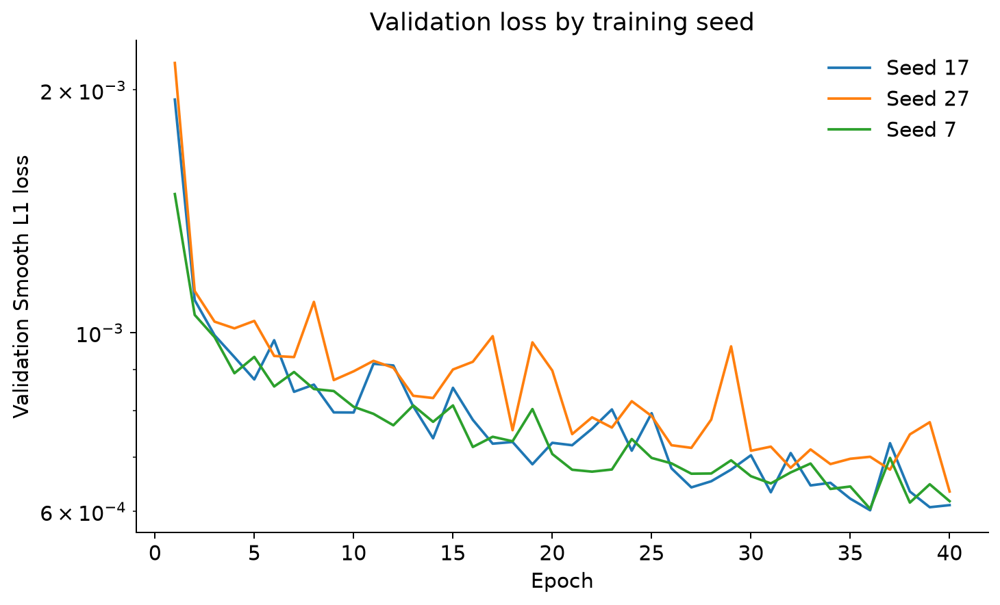
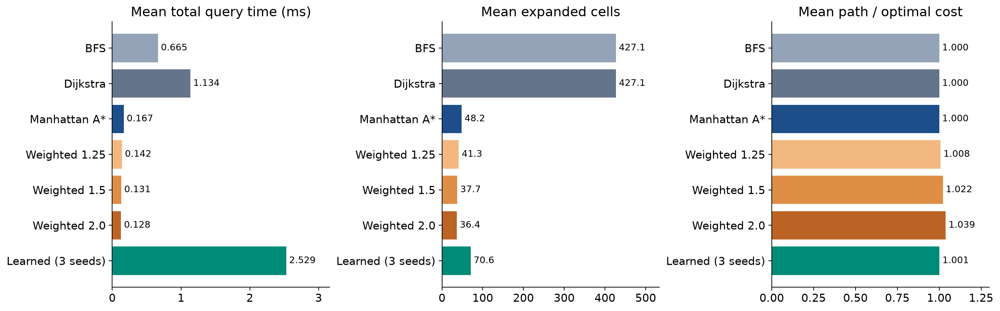
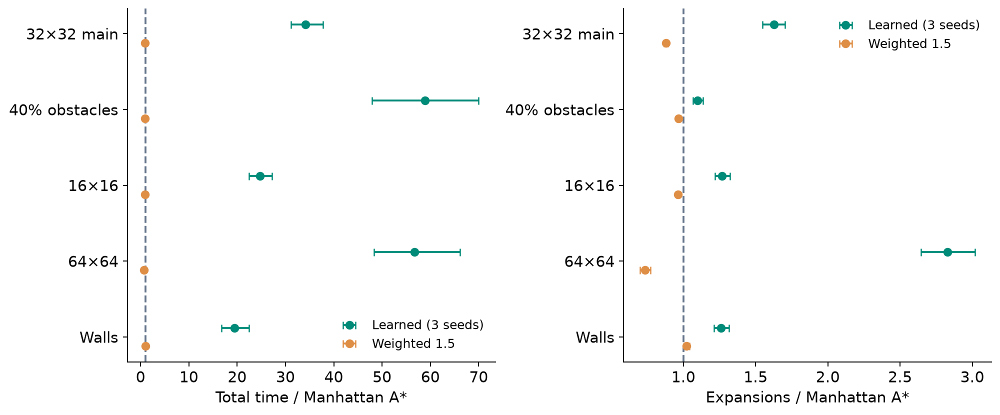
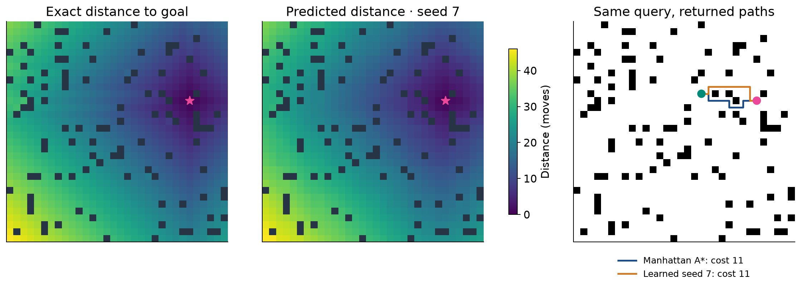

# Learning Heuristics for A* Search with Obstacles

This report records the original experiment. The [research synthesis](final_report.md) covers the later training, reuse, and landmark studies; the future-work suggestions below reflect the original stage.

CSCI/ARTI 4550/6550 · University of Georgia

## 1. Research question

A* uses the cost of reaching a cell and an estimate of the remaining distance to decide what to explore next. On a four-direction grid, Manhattan distance is a simple estimate: it adds the horizontal and vertical distance to the goal. It is inexpensive to calculate and gives a lower bound when every move costs one. However, it ignores obstacles. A wall can force a long detour even when the goal looks close.

This project asks whether a small neural network can use obstacle information to provide a more useful estimate. There are three questions. Does the learned heuristic reduce the number of expanded cells? Does it reduce total query time after including the network? How much does the returned path differ from a shortest path? We also test whether the same model works when the map size, obstacle density, or obstacle arrangement changes.

These questions need separate measurements. A model can expand fewer cells but still be slower because inference takes time. It can also appear efficient by accepting longer paths. We therefore compare search effort, runtime, path quality, and success together. The goal is an empirical comparison under a clear setup, rather than a claim that adding a neural network must improve search.

## 2. Related work

The project follows the basic A* idea of combining distance traveled with a heuristic estimate of remaining cost. Hart, Nilsson, and Raphael introduced its formal foundation in 1968 [1]. Weighted heuristic search provides another way to change the balance between exploring carefully and following the heuristic [2]. This makes Weighted A* an important baseline: a learned model should be compared with an inexpensive adjustment to an existing method, as well as with ordinary A*.

Learning a heuristic is not a new research direction. Takahashi and colleagues studied neural networks for estimating planning heuristics and considered how the training loss affects their usefulness [3]. Bhardwaj and colleagues instead trained a policy to choose which search node to expand by imitating an oracle [4]. Yonetani and colleagues developed Neural A*, combining a convolutional encoder with a differentiable version of A* so that the planner can be trained end to end [5].

Our implementation is deliberately smaller in scope. The CNN learns exact distances from supervised examples, and an ordinary A* implementation reads those predictions. We do not train through search or imitate expansion decisions. This separation makes the experiment easier to inspect, but it also means the training objective does not directly reward fewer expansions or faster queries. The contribution is the controlled comparison and the analysis of its limits, rather than a new search algorithm or a reproduction of those papers.

## 3. Maps and exact distances

The main experiment uses 32×32 grids with four-direction movement, fixed obstacles, and unit move cost. The complete map is available before a query starts. Half the maps in each main split have 10% obstacles and half have 25%. The generator selects exactly the rounded requested number of blocked cells, without replacement.

There are 1,200 training maps, 200 validation maps, and 300 main test maps. Training and validation use two distinct free goals per map, giving 2,400 training examples and 400 validation examples. Each test map has one free goal and four different free starts, giving 1,200 main queries. Four additional test sets have 150 maps and 600 queries each: 32×32 with 40% obstacles, 16×16 with 25%, 64×64 with 25%, and 32×32 wall layouts. Wall maps contain long barriers with gaps, rotated to vary their direction. Their density is recorded rather than forced to equal a random-map density.

We split whole obstacle layouts. A layout and its rotations have a shared group identifier, and repeated groups are rejected across all splits. This prevents goals or cells from the same map from leaking between development and evaluation. The generator records map seeds, dimensions, actual density, reachable fractions, layout identifiers, and file checksums. All 2,300 layouts were distinct and had enough free cells for their assigned endpoints.

Endpoints are sampled without checking whether a route exists. Keeping unreachable queries matters because excluding them would change the task being measured. Reverse BFS starts at the goal and labels every reachable free cell with its shortest distance. Blocked cells use a separate marker from unreachable free cells. Both kinds are excluded from the training loss. Labels are checked independently through local distance conditions: the goal is zero, adjacent reachable distances differ by at most one, and every positive distance has a neighbor one step closer.

## 4. Model and training

The CNN receives five channels for each map-goal example: obstacle occupancy, a goal marker, signed row offset from the goal, signed column offset, and Manhattan distance. Row and column offsets are divided by the corresponding dimension minus one. Distances are divided by the sum of those dimension spans, with a minimum scale of one. Targets are not clipped, so routes that take long detours can exceed one after normalization.

The network contains five 3×3 convolution layers with 32 channels and ReLU activations. Their dilation values are 1, 2, 4, 8, and 16. Padding preserves the grid dimensions. A final 1×1 convolution and Softplus produce one nonnegative estimate per cell. The network has 38,497 parameters and a theoretical 63×63 receptive field. It accepts different input sizes, although accepting a larger grid does not guarantee accurate predictions on it.

Training uses Smooth L1 loss on reachable free cells. We first average the loss within each map-goal example and then across the batch. This keeps a map with a small reachable region from receiving less weight merely because it has fewer valid labels. Training uses Adam, learning rate 0.001, batch size 16, and seeds 7, 17, and 27. Each seed has a maximum of 40 epochs, with early stopping after ten epochs without validation improvement. The lowest validation-loss checkpoint is saved for each seed.

The epoch budget and four-thread CPU training setting were fixed after a small separate pilot and a throughput check. Final test measurements were not used to adjust them. Training reads only the training and validation splits. Each checkpoint records its dataset checksum and development layout groups, and evaluation rejects overlap with held-out maps. This makes the separation check part of the executable workflow, rather than just a convention.

## 5. Search and measurement

We compare BFS, Dijkstra, Manhattan A*, Weighted A* with weights 1.25, 1.5, and 2.0, and learned A* for each of the three trained seeds. The priority-queue methods share one search loop. They order entries by estimated total cost, then prefer larger distance traveled when priorities tie, and finally use insertion order. They skip stale queue entries and allow reopening after finding a lower-cost route to a cell.

For learned A*, the model predicts a full distance map once per query. Predictions are converted back to distance units, and the goal estimate is set to zero. The search then looks up the prediction for each cell. The model cannot declare an obstacle or remove a valid neighbor; it only changes the priority. Because its estimate can exceed the true remaining distance, the returned route has no optimality guarantee. Every returned path is checked for valid endpoints, free cells, adjacent steps, and reported cost. Baseline costs are checked against exact labels, including the expected Weighted A* bound.

Every query is run five times per method after warm-up, with shuffled method order. Query timing uses one CPU thread. The learned timer includes input preparation, a fresh model prediction, search, and path reconstruction. Predictions are not reused between timing repetitions. Model loading is measured separately. Reference BFS, validation, data loading, and saving results are outside query timing. Each run has a soft five-second limit and a limit of one million expansions; reaching a limit is recorded as an incomplete attempt.

We take the median timing repetition for each query and report means, medians, quartiles, and slow cases across queries. Completion-time summaries exclude incomplete attempts, while attempted time and status remain available. Reachable-query success and unreachable-query correctness have separate denominators. Path ratios use successful queries with positive optimal cost. The start and goal are always different in evaluation.

Paired ratios compare methods on the same query. For uncertainty, we average within maps and use 2,000 bootstrap samples of whole maps. The combined learned estimate averages the three seeds within each map before resampling. Individual seeds are also reported. These intervals describe variation across maps for the saved models; they do not estimate every possible training outcome or machine. In particular, five timing repetitions are not five independent test queries. The complete records remain available so that aggregate results can be checked.

## 6. Recorded results

The full evaluation contains 900 held-out maps, 3,600 queries, nine method settings, and five timing repetitions, giving 162,000 timed runs. The main test contains 300 maps and 1,200 queries. The remaining 600 maps are the four generalization sets. Training finished before query evaluation began.

Training took 18.73 minutes in total. All three seeds ran for 40 epochs. The selected epochs were 36, 36, 40 for seeds 7, 17, and 27, respectively. Their best validation losses were 0.000604, 0.000602, 0.000635. These losses are measured in normalized distance units and should not be read as errors in grid moves.

Of the 1,200 main queries, 1184 had a valid route and 16 were unreachable. The following table uses the median timing repetition for each query and then takes arithmetic means. The learned row gives equal weight to the three seeds. Path statistics use found paths; time and expansion statistics include completed unreachable searches.

| Method | Mean ms | Median ms | Mean expanded | Mean path / optimal | Optimal found paths |
| --- | ---: | ---: | ---: | ---: | ---: |
| BFS | 0.665 | 0.660 | 427.1 | 1.000 | 100.0% |
| Dijkstra | 1.134 | 1.118 | 427.1 | 1.000 | 100.0% |
| Manhattan A* | 0.167 | 0.115 | 48.2 | 1.000 | 100.0% |
| Weighted A* 1.25 | 0.142 | 0.107 | 41.3 | 1.008 | 88.8% |
| Weighted A* 1.5 | 0.131 | 0.101 | 37.7 | 1.022 | 76.4% |
| Weighted A* 2.0 | 0.128 | 0.099 | 36.4 | 1.039 | 65.7% |
| Learned, three seeds | 2.529 | 2.325 | 70.6 | 1.001 | 98.3% |

There were 0 query-method cases with incomplete or mixed-limit outcomes across the evaluated splits. The saved summary gives reachable success, unreachable correctness, and every status separately for each method. It also contains quartiles, 95th percentiles, maximum times, and reopening counts.

For the learned method, the mean paired runtime ratio relative to Manhattan A* was 34.121 [31.160, 37.774], and the expansion ratio was 1.629 [1.549, 1.702]. Brackets show the 95% map-bootstrap interval. These averages compare matched queries within maps. They differ from dividing the two overall mean times, because the latter gives more influence to queries with large baseline runtimes.

## 7. Generalization and prediction error

The next table shows the combined learned method on each condition. Time and expansion ratios compare it with Manhattan A* on the same queries, with the three models averaged inside each map. A value above one means more time or search work. The path ratio compares the returned cost with the exact shortest cost. The route count belongs to the underlying queries and is counted once, not once per model.

| Condition | Reachable queries | Time / A* [95% CI] | Expansions / A* [95% CI] | Mean path / optimal |
| --- | ---: | ---: | ---: | ---: |

| 32×32 main | 1184 / 1200 | 34.121 [31.160, 37.774] | 1.629 [1.549, 1.702] | 1.001 |
| 32×32, 40% obstacles | 226 / 600 | 58.912 [47.922, 69.984] | 1.098 [1.065, 1.137] | 1.005 |
| 16×16, 25% obstacles | 573 / 600 | 24.774 [22.476, 27.235] | 1.266 [1.218, 1.321] | 1.002 |
| 64×64, 25% obstacles | 586 / 600 | 56.706 [48.373, 66.119] | 2.827 [2.644, 3.017] | 1.017 |
| 32×32, walls | 600 / 600 | 19.427 [16.750, 22.467] | 1.259 [1.211, 1.314] | 1.001 |

Prediction errors were calculated on reachable free cells, first within each map and then across maps. Overestimate frequency counts estimates greater than the exact distance by more than a small numerical tolerance. The correlation column compares each map's mean absolute error with its mean expansion ratio relative to Manhattan A*. It is a descriptive association, not evidence that changing error alone causes a change in search effort.

| Seed | MAE, moves | RMSE, moves | Overestimate frequency | Error–expansion correlation |
| --- | ---: | ---: | ---: | ---: |

| 7 | 1.301 | 1.849 | 51.8% | -0.346 |
| 17 | 1.413 | 1.927 | 59.4% | -0.289 |
| 27 | 1.380 | 1.936 | 47.2% | -0.381 |

The example above uses the first main-test map and first start in the manifest, with seed 7 fixed in advance. It was not selected for an unusually good outcome. Exact and predicted distance maps use the same color scale. Masked cells are blocked or unreachable, and the path panel shows the actual returned routes. This example explains the model output; aggregate measurements support the performance comparison.

## 8. Interpretation and limitations

The learned heuristic did not improve the main search comparison. Its mean query time was 2.529 ms, compared with 0.167 ms for Manhattan A*, and it expanded 70.6 cells rather than 48.2. This result cannot be explained only by inference overhead: even before considering runtime, the learned priority order required more expansions. BFS and Dijkstra expanded many more cells, but their inexpensive operations still gave lower mean times than the learned method on these small grids.

Path quality was a stronger part of the learned result. Across the three seeds, 98.3% of found main-test paths were optimal, and the mean cost ratio was 1.0014. However, the largest observed ratio was 1.333. A high optimal fraction does not create a guarantee, and a small mean can hide a few substantial relative detours. Weighted A* at 1.5 offered a different tradeoff: it expanded 37.7 cells on average and took 0.131 ms, while its mean path ratio was 1.0219 and 76.4% of found paths were optimal. It was a useful inexpensive alternative when a somewhat longer path was acceptable.

The model's mean absolute distance errors were about 1.3 to 1.4 moves on the main set. These values did not lead to better search ordering than Manhattan A*. One possible explanation is that many random-map routes are already close to Manhattan distance. The larger-g tie rule also lets ordinary A* follow promising equal-priority routes directly. Small continuous prediction errors can disturb those priorities. This is an interpretation, not a tested causal explanation; an ablation of tie rules or the training objective would be needed to separate the effects.

The negative error–expansion correlations do not mean inaccurate predictions improve search. Their expansion metric is relative to Manhattan A*, whose own effort changes across maps. Obstacle density, route length, and connectivity can affect both prediction error and that denominator. Even among the three seeds, a lower distance error did not give a simple ranking of search effort. This supports using actual query performance as the main evaluation rather than choosing a model from distance error alone.

Generalization did not reverse the main conclusion. The learned method used more expansions and more paired query time in every condition. On 64×64 grids, the mean paired expansion ratio rose to 2.827, and the mean path ratio was about 1.017. The network accepts this size, but it was trained only on 32×32 maps and cannot view an entire larger map from every cell. Wall layouts also failed to produce an advantage, despite their longer detours. These observations limit the usefulness of this particular model; they do not establish that every learned planner would fail on these tasks.

Connectivity helps explain the runtime ratios. In the 40% obstacle set, only 226 of 600 queries had a route. Some unsuccessful baseline searches ended after exploring a small component, whereas the CNN still predicted a full grid. Large paired ratios therefore do not necessarily mean long absolute delays. The learned mean time in that condition was 2.740 ms. Reporting route counts, absolute times, and paired ratios together gives a more useful picture than treating obstacle density as a direct measure of difficulty.

All evaluated methods found routes on every reachable query and correctly reported no route for unreachable queries. No run reached a time or expansion limit. The learned median main-query time was 2.325 ms, its middle half ranged from 2.181 to 2.588 ms, and its 95th percentile was 3.595 ms. Timings came from one ARM Mac running macOS 15.7.3, Python 3.14.3, and PyTorch 2.15.0. They describe this implementation and environment, not a hardware-independent ranking of every possible implementation.

Model loading took approximately 17.9, 5.6, and 7.1 ms for seeds 7, 17, and 27. These were single startup measurements, not repeated latency estimates. Reverse BFS preprocessing averaged 1.112 ms per main map-goal, measured separately. Because several starts share a goal, reusing an exact distance map is a promising comparison for a different workload. The current experiment charges each query for a fresh learned prediction and does not claim an amortized advantage over cached exact distances. Reverse BFS time alone also excludes constructing a returned path, so it is not a complete additional pathfinder benchmark.

## 9. Conclusion and reproducibility

Under this setup, learning exact distances with a small supervised CNN preserved path quality reasonably well but did not improve speed or search effort. Manhattan A* was a stronger default, and Weighted A* offered a clear speed–path-length tradeoff. The experiment answered the research question with a negative result for the tested model, which is still useful: it shows why accurate-looking predictions and low training loss are insufficient evidence of a better search method.

The main limits are one architecture, a 40-epoch budget, three seeds, generated static maps, and one CPU environment. There was no broad hyperparameter search or direct optimization of search decisions. Further work could train a loss based on search behavior, include wall layouts and multiple grid sizes during development, or compare repeated queries to the same goal. Those choices should be developed on new validation data and assessed on a fresh test split, rather than tuned against the results reported here.

The repository saves configurations, dataset metadata, selected checkpoints, training histories, aggregate results, compressed query and map records, and figures. The raw timing file has 162,000 records and remains in the local experiment output. `scripts/run_experiment.py` rebuilds the complete workflow in a fresh directory. Correctness checks include 170 tests, exhaustive small-grid baseline comparisons, independent distance-label verification, checkpoint loading, leakage rejection, inference timing, and the interactive shell. The terminal demo accepts newly drawn maps and runs the saved models, which lets the presentation illustrate real behavior without requiring a separate graphical interface.

## References

1. Hart, P. E., Nilsson, N. J., and Raphael, B. (1968). A formal basis for the heuristic determination of minimum cost paths. *IEEE Transactions on Systems Science and Cybernetics*, 4(2), 100–107. [DOI](https://doi.org/10.1109/TSSC.1968.300136).
2. Pohl, I. (1970). Heuristic search viewed as path finding in a graph. *Artificial Intelligence*, 1(3–4), 193–204. [DOI](https://doi.org/10.1016/0004-3702(70)90007-X).
3. Takahashi, T., Sun, H., Tian, D., and Wang, Y. (2019). Learning heuristic functions for mobile robot path planning using deep neural networks. *ICAPS*, 29(1), 764–772. [Paper record](https://merl.com/publications/TR2019-072).
4. Bhardwaj, M., Choudhury, S., and Scherer, S. (2017). Learning heuristic search via imitation. *PMLR*, 78, 271–280. [Paper](https://proceedings.mlr.press/v78/bhardwaj17a.html).
5. Yonetani, R., Taniai, T., Barekatain, M., Nishimura, M., and Kanezaki, A. (2021). Path planning using Neural A* search. *PMLR*, 139, 12029–12039. [Paper](https://proceedings.mlr.press/v139/yonetani21a.html).
