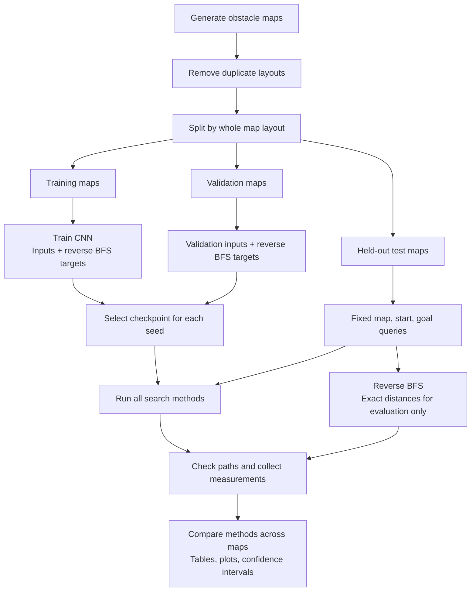
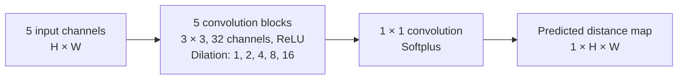
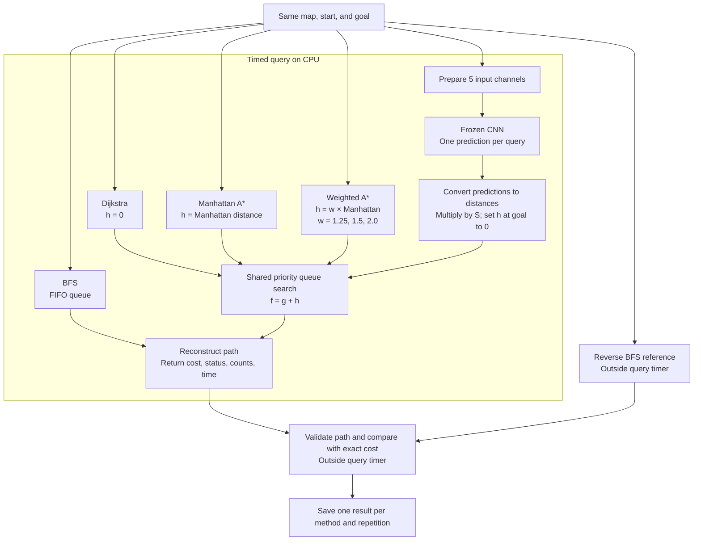
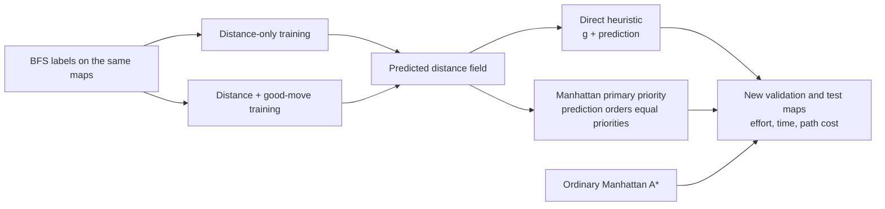
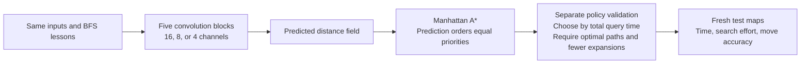
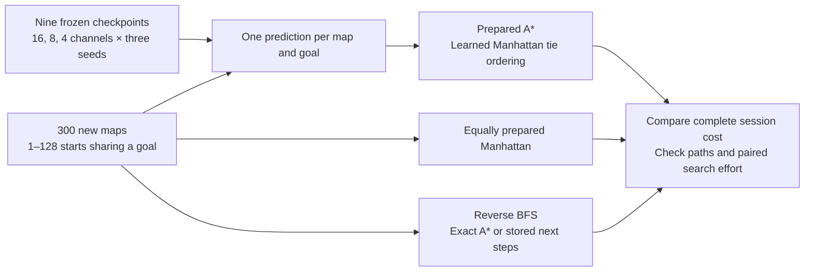
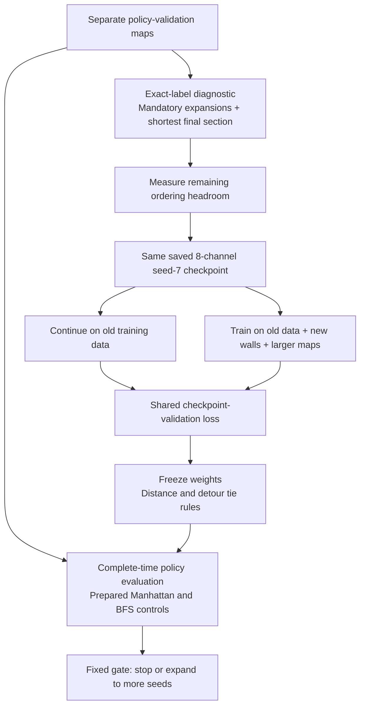
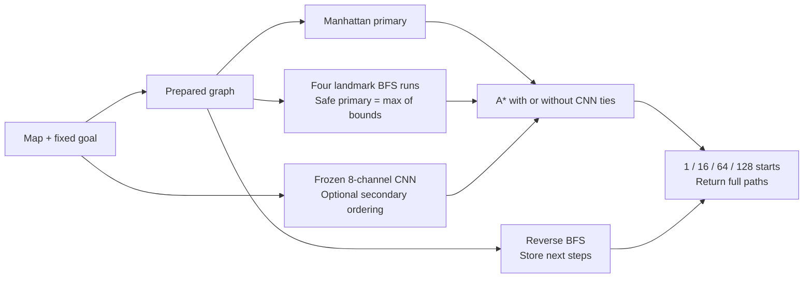
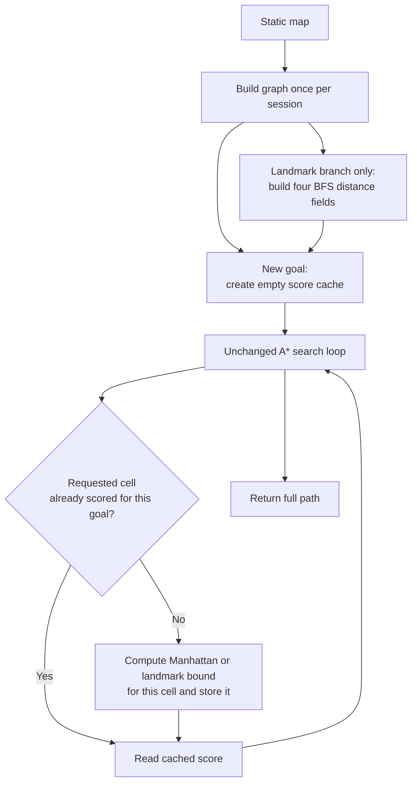

# Experiment architecture

The experiment compares search effort, total query time, and path quality on the same grid queries. Maps are fully known, movement is four-way, and every move costs one. The pipeline connects dataset preparation, CNN training, baseline and learned search, and held-out evaluation.

The sections below first describe the original experiment. The later sections show the follow-up changes: route training, Manhattan tie ordering, prepared search, and smaller model widths. Their linked plans and results contain the settings for each round.

## Experiment flow

Validation selects the checkpoint; test maps do not affect training or model selection. Exact test distances go only to evaluation, never to the learned heuristic.

## Dataset

| Split | Maps | Queries or labels per map |
| --- | ---: | --- |
| Training | 1,200 | Two free goals; exact distances to each goal. |
| Validation | 200 | Two free goals; the same label process. |
| Test | 300 | One free goal and four different free starts, excluding the goal. |

These sets use 32×32 grids, split equally between 10% and 25% obstacles. Generate exactly `round(p * H * W)` blocked cells. Keep all goals and any rotated copies of a layout in the same split. Record seeds, layout IDs, actual obstacle fraction, reachable-cell fraction, and optimal distances.

Reverse BFS marks blocked and unreachable cells separately. Sample endpoints without requiring a route; retain unreachable queries and record maps with too few free cells. File checksums and independent label checks verify the generated dataset.

Additional test sets contain 150 maps each: 32×32 at 40% obstacles, 16×16 and 64×64 at 25%, and 32×32 walls/corridors. Wall layouts have a different structure and do not match the random-map density exactly.

## Distance model

| Part | Design |
| --- | --- |
| Inputs | Obstacles, goal marker, signed row and column offsets, Manhattan distance. |
| Scaling | Row/column offsets use `max(H - 1, 1)` / `max(W - 1, 1)`. Distances use `S = max(H + W - 2, 1)`. |
| Targets | Exact BFS distances divided by `S`; do not clip at one, since detours can exceed `S`. |
| Loss | Smooth L1 on reachable free cells, averaged per map-goal example and then per batch. |
| Training | Adam, learning rate 0.001, batch size 16, at most 40 epochs; stop after 10 epochs without validation improvement. |
| Checkpoints | Best validation model for each of three random seeds. Fix settings before final testing. |

Matching padding preserves the map size. The model has about 39,000 parameters and a 63×63 receptive field, which may miss distant obstacles on 64×64 maps. Blocked and unreachable cells are excluded from loss; their predictions do not determine which search cells are skipped.

## One query through the system

Each branch runs separately on the same query. The priority queue uses the same tie rules, reopening, and stopping behavior for every heuristic; these are defined in [Search baselines](search_baselines.md). BFS, Dijkstra, and Manhattan A* return shortest paths. Weighted A* is checked against `w × optimal_cost`; learned A* has no optimality guarantee.

Use fixed CPU thread settings, warm-up runs, varied method order, and five timed repetitions per query. Use the median repetition for analysis, with fresh predictions each time. File loading, label generation, path validation, and result writing stay outside the timer. Report model loading, training time, and reverse BFS reference time separately.

## Outputs and comparisons

| Output | Comparison |
| --- | --- |
| Search work | Total and unique expansions, generated neighbors, queue counts, and reexpansions. |
| Runtime | Total query time, including learned input preparation and inference. |
| Path quality | Cost / optimal cost, fraction of optimal paths, and success rate. |
| Prediction quality | Mean absolute error, root mean squared error, and frequency/size of overestimates on reachable cells. |
| Query status | Found, no path, time limit, or expansion limit; retain every outcome. |

Report means, medians, the middle half of measurements, and slow cases. Compute path ratios only for successful queries with positive optimal cost; show failures and unreachable cases separately. A limited search is incomplete, and its elapsed time is not a completion time.

For 95% bootstrap intervals, resample whole maps with their queries and method results kept together. Average the three models within each map for the main interval, and show each seed separately. This estimates variation across maps for those models; timing repetitions are not new independent samples. Summarize prediction errors per map and compare them with search performance without assuming causation.

## Follow-up experiment

The [follow-up architecture](research_followup.md) adds a separate branch with mixed random and wall training maps, three controlled model variants, validation search selection, and a fresh test set. Its diagram shows where the branches meet. The original dataset, checkpoints, and results remain separate so the two experiments can be compared.

## Learning search preferences

The [third experiment](search_learning.md) keeps the same mixed training data and smaller CNN. It compares two learning objectives and two ways to use each output:

The tie rule keeps Manhattan's primary ordering, so learned scores cannot sacrifice optimal path cost. Separate policy-validation maps select the learned tie family before another test set is generated. Exact test distances supply labels for evaluation and the explicitly marked oracle controls; they are never model inputs.

## Reusing a map and goal

The [runtime architecture](runtime_reuse.md) adds a timed session around several queries. Its diagram separates map preparation, one shared prediction, repeated A*, and the reverse-BFS policy. The prepared Manhattan and learned branches use the same search implementation. Every session discards earlier prepared state, and a changed map or goal requires a new planner. The [results](runtime_results.md) include all setup costs.

## Smaller route models

Only channel width changes. Depth, dilation, training data, loss, and search remain fixed. The [plan](lightweight_models.md) defines the selection rule, and the [results](lightweight_results.md) compare all three widths with Manhattan. This round measures a fresh prediction for every query.

## Smaller models with reuse

The [reuse comparison](lightweight_reuse.md) combines the previous two changes without retraining. All preparation is charged once per session, including CNN inference or reverse BFS. Whole-map comparisons show whether smaller predictions save enough time to offset their setup cost. Test results do not change the earlier validation choice.

## Ordering ceiling and a training pilot

The [pilot plan](order_pilot.md) separates exact-information diagnostics from practical model timing. Exact distances do not enter model inputs. The two training branches receive the same number of updates and use the same network. The [results](order_pilot_results.md) report validation evidence and the gate outcome; existing test maps stay outside training and selection.

## Safe primary estimates and measured preparation

The [timing pilot](landmark_timing.md) charges every preparation step once per session and rebuilds state for each measurement. Model weights are resident; their one-time load cost is reported separately. Landmarks supply the stronger primary estimate, while the CNN remains a tie breaker. The [results](landmark_timing_results.md) separate the classical search improvement from the model's added cost. All methods retain optimal path costs.

The [changing-goal follow-up](changing_goals.md) reuses the graph and landmark index across 128 queries on one map. All methods keep their own per-goal cache. A new goal creates new score fields, a new CNN prediction where used, or a new reverse-BFS policy. Returning to a cached goal reuses that state. Each measured session starts with empty caches and pays all preparation costs. The [results](changing_goals_results.md) distinguish map reuse from goal reuse.

## Computing scores during search

The [on-demand experiment](demand_heuristic.md) compares this branch with full-field construction for both Manhattan and landmarks. Each cell receives the same score as before, so paths and search counters must match exactly. Cache misses move some work from goal preparation into search; the complete timer includes both. A fixed validation gate controls expansion to fresh test maps, including 128×128 grids. This branch uses no neural predictions and does not change existing checkpoints.
