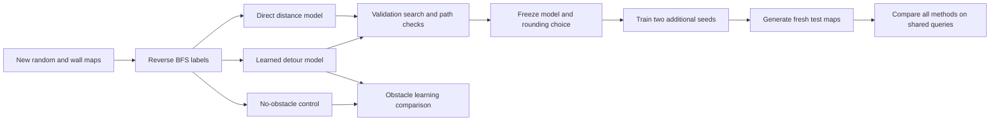

# Follow-up experiment

The first experiment found that the CNN expanded more cells and took longer than Manhattan A*. This follow-up asks whether it learned obstacle-dependent detours, and whether a different target and training distribution improve search. The original results remain the baseline.



## Plan fixed before the new test

The development set contains 800 random and 400 wall maps for training, plus 160 random and 80 wall maps for validation. Each has two goals. Layouts and their rotations are excluded if they appeared anywhere in the first dataset. Wall maps provide more examples where Manhattan distance misses a long detour.

Three models use the same 16-channel network, examples, optimizer, and initial seed 7:

| Model | Prediction | Obstacle input |
| --- | --- | --- |
| Direct | Full distance | Available |
| Residual | Manhattan plus a nonnegative learned detour | Available |
| No-obstacle control | Manhattan plus a nonnegative learned detour | Set to zero during training and inference |

Each run allows 60 epochs and stops after 12 without validation improvement. Its lowest validation-loss checkpoint is retained. The narrower network also reduces prediction cost; comparisons with the original 32-channel model therefore change both data and capacity. Comparisons among the three new models control these factors. This is a small, planned comparison, not a broad architecture search.

The detour variants initialize the output bias to −4 before the positive output function. This starts their extra distance near zero, close to Manhattan. The direct variant keeps the usual layer initialization. This initialization difference is part of the target-design comparison.

Search tests both raw predictions and a rounded version. On this four-neighbor unit-cost grid, a reachable distance differs from Manhattan by an even number. Rounding uses `Manhattan + 2 * round(max(prediction - Manhattan, 0) / 2)`. This keeps Manhattan as a floor and reduces small ordering changes. Neither form guarantees an admissible heuristic or an optimal path.

Selection uses validation queries only. For each map, it averages expansion ratios over reachable queries, then averages maps within the random and wall groups and gives the two groups equal weight. Candidates must achieve complete search, mean path ratio at most 1.02, and at least 90% optimal paths in each group. Among eligible full-input candidates, the lowest expansion score wins. If none qualifies, the lowest worst-group mean path ratio wins, followed by the expansion score; that outcome is reported as a failed quality gate. The no-obstacle control cannot be selected. The selected architecture is trained again with seeds 17 and 27; its search rounding choice stays fixed.

Only after selection, a fresh test set is generated: 200 random 32×32 maps and 100 each of dense 32×32, 16×16, 64×64, and wall 32×32 maps. It excludes every layout group in the original and new development sets. No training step reads its labels. Test results cannot change the selection in this experiment.

Walls are now part of training, so fresh wall maps test new layouts within a known map family. The 16×16, 64×64, and 40% density groups test conditions outside the new training distribution.

## What the measurements mean

An exact-distance heuristic provides a search-only reference: it shows the expansions possible when distances are already known. Its lookup timing excludes building those distances and is not an end-to-end competitor. A separate method includes reverse BFS and search in every query. Ordinary Manhattan and Weighted A* remain the practical comparisons.

The new controls compare prediction error with Manhattan, distinguish cells needing a detour, and hide obstacles from a trained model at inference. Hiding inputs after training changes its input distribution; the separately trained no-obstacle model is the stronger control. Better distance error alone does not establish better pathfinding.

Each query gets a fresh prediction. Timing includes input preparation, model inference, search, and path reconstruction. Five repetitions run in shuffled order with one CPU thread. Confidence intervals resample maps. Model seed variation is reported separately; three seeds do not establish performance for every possible training run.

After the validation quality gate failed, an exploratory diagnostic was added: the fraction and size of neighboring prediction differences greater than one step. This examines local consistency. It does not change selection or the frozen test protocol, and it cannot by itself explain search performance.

## Input and target scaling

For a grid of height `H` and width `W`, the distance scale is `S = max(H + W - 2, 1)`. Obstacles and the goal marker are binary. Signed row and column offsets are divided by `max(H - 1, 1)` and `max(W - 1, 1)`. Manhattan distance and exact BFS distance are divided by `S`.

On a 32×32 map, `S = 62`. If Manhattan distance is 10 and BFS distance is 22, the input distance is `10/62` and the target is `22/62`. The residual model adds a learned `12/62` detour to the Manhattan input. At inference, the output is multiplied by 62. Targets are not clipped to one: a long route can exceed 62 steps. Blocked and unreachable cells are masked out of training.

These features provide useful prior knowledge: grid geometry and a simple lower bound. The labels provide correct examples. They do not give the CNN a built-in shortest-path algorithm, which is why the controls above are needed.

## Reproduction

The original dataset must be available so the generator can exclude all previously used layouts. Each stage keeps the previous stage's evidence and rejects existing output directories. Run these stages in order:

```sh
python scripts/run_research.py develop
python scripts/run_research.py select
python -m learned_astar.research.diagnose
python scripts/run_research.py replicate
python scripts/run_research.py test
python -m learned_astar.research.plot --run outputs/research_v2 --output results/research_v2_figures
python scripts/archive_research.py
python scripts/report_research.py
```

Use `--run` with a new directory for another complete run. `develop --resume` skips completed candidate runs after checking that the protocol is unchanged. Partial model directories are preserved and must be moved aside before restarting their run. Raw repeated measurements stay in the run directory; the archive keeps the selected checkpoints, every candidate's history, map and query records, checksums, and aggregate results.
