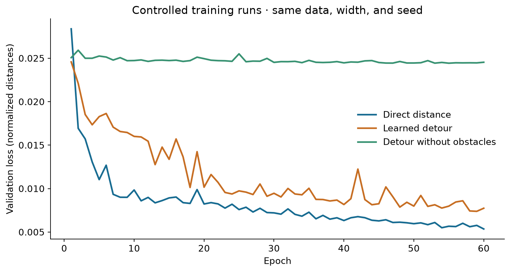
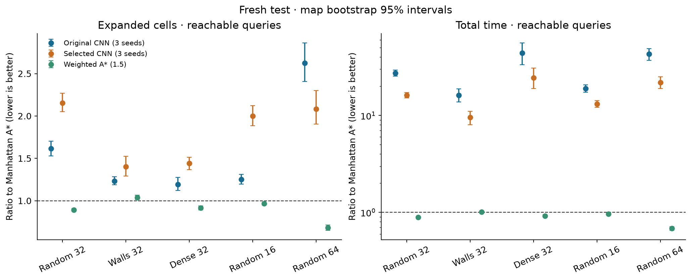
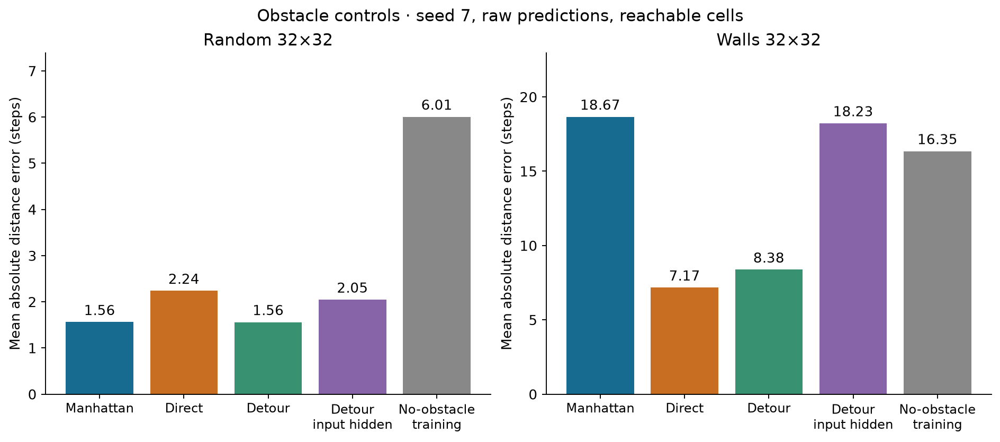
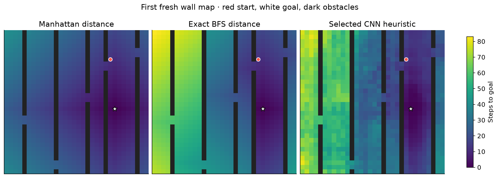

# Follow-up research results

This experiment follows the [fixed plan](research_followup.md). It keeps the [first experiment](report.md) as the original baseline and evaluates new models on newly generated maps. Results below come from the saved measurements, rather than from the single-query terminal demo.

The network learned useful information about wall detours, but this round did not produce a faster replacement for Manhattan A*. On fresh wall maps, the seed-7 direct model has mean distance error 7.17 steps, compared with 18.67 for Manhattan. The selected three-seed configuration takes 0.936 ms per query versus 0.337 ms for Manhattan A*, and returns an optimal path in 65.2% of wall queries. It had already failed the validation quality gate.

## What changed

The new training set has 800 random maps and 400 wall maps, with two goals per map. Validation has 240 separate maps. All new networks have 10,033 parameters, compared with 38,497 in the original model. Three controlled runs compare full distance prediction, a learned detour added to Manhattan, and a detour model without obstacle inputs. The optimizer, data, width, and screening seed are shared.

The original random training maps have a mean detour of 1.47 steps per reachable cell. The new wall maps have a mean detour of 18.49 steps. This changes the examples the network learns from, rather than only training longer on the same distribution.

## Validation choice

The predeclared rule selected the **direct model with raw predictions**. No candidate passed the path-quality gate on both validation groups. The fallback rule chose the lowest worst-group mean path ratio, then the expansion score. This is a failed quality gate, not a successful validation claim.

| Candidate | Search form | Mean reachable expansion ratio | Worst-group mean path ratio | Passes gate |
| --- | --- | ---: | ---: | --- |
| direct | raw | 1.706 | 1.0188 | No |
| direct | parity | 1.393 | 1.0359 | No |
| residual | raw | 1.392 | 1.0197 | No |
| residual | parity | 1.156 | 1.0316 | No |

The expansion score gives random and wall maps equal weight. The selected architecture was then trained with seeds 17 and 27, without changing its search form. Only after that were 600 fresh test maps generated. The archive verifies that the 2,300 original, 1,440 new development, and 600 fresh test layout groups do not overlap, including rotations.

## Fresh test comparisons

Times include a fresh prediction and search for every query. Rows average per-query medians of five repetitions. The exact-distance lookup is an oracle reference: its distances are supplied in advance, so its time is not comparable as an end-to-end method. The separate fresh-BFS row includes constructing them.

### Random 32×32 maps

| Method | Total ms | Expanded cells | Mean path ratio | Optimal paths |
| --- | ---: | ---: | ---: | ---: |
| Manhattan A* | 0.091 | 52.1 | 1.0000 | 100.0% |
| Weighted A* (1.5) | 0.075 | 42.6 | 1.0208 | 77.0% |
| Original CNN, 3 seeds | 1.238 | 73.5 | 1.0023 | 98.1% |
| Direct CNN, seed 7, raw | 0.766 | 89.9 | 1.0053 | 95.9% |
| Direct CNN, seed 7, rounded | 0.762 | 74.3 | 1.0226 | 80.2% |
| Detour CNN, seed 7, raw | 0.733 | 68.4 | 1.0002 | 99.7% |
| Detour CNN, seed 7, rounded | 0.726 | 53.7 | 1.0045 | 96.2% |
| No-obstacle control, seed 7 | 0.697 | 42.4 | 1.0025 | 96.8% |
| Selected CNN, 3 seeds | 0.772 | 94.0 | 1.0064 | 94.3% |
| Exact-distance lookup | 0.064 | 30.6 | 1.0000 | 100.0% |
| Fresh reverse BFS + search | 0.630 | 30.6 | 1.0000 | 100.0% |

On reachable queries, the selected model's mean paired expansion ratio is **2.156** (95% map-bootstrap interval 2.051–2.269). The exact-distance reference has ratio 0.729. Ratios below one indicate fewer expansions than Manhattan A*. A mean of paired ratios differs from dividing the two means in the table.

Selected models spend 0.610 ms on prediction and 0.153 ms on search on average. These components are summarized separately, so their medians need not add exactly to total time. The worst observed path ratio is 1.444.

### Wall 32×32 maps

| Method | Total ms | Expanded cells | Mean path ratio | Optimal paths |
| --- | ---: | ---: | ---: | ---: |
| Manhattan A* | 0.337 | 215.3 | 1.0000 | 100.0% |
| Weighted A* (1.5) | 0.339 | 221.4 | 1.0011 | 97.8% |
| Original CNN, 3 seeds | 1.450 | 238.4 | 1.0006 | 98.8% |
| Direct CNN, seed 7, raw | 0.924 | 194.9 | 1.0182 | 71.8% |
| Direct CNN, seed 7, rounded | 0.942 | 188.0 | 1.0337 | 59.0% |
| Detour CNN, seed 7, raw | 0.921 | 198.5 | 1.0104 | 81.2% |
| Detour CNN, seed 7, rounded | 0.956 | 198.7 | 1.0219 | 71.8% |
| No-obstacle control, seed 7 | 0.940 | 218.4 | 1.0000 | 100.0% |
| Selected CNN, 3 seeds | 0.936 | 205.5 | 1.0225 | 65.2% |
| Exact-distance lookup | 0.094 | 41.9 | 1.0000 | 100.0% |
| Fresh reverse BFS + search | 0.680 | 41.9 | 1.0000 | 100.0% |

On reachable queries, the selected model's mean paired expansion ratio is **1.402** (95% map-bootstrap interval 1.290–1.524). The exact-distance reference has ratio 0.403. Ratios below one indicate fewer expansions than Manhattan A*. A mean of paired ratios differs from dividing the two means in the table.

Selected models spend 0.595 ms on prediction and 0.331 ms on search on average. These components are summarized separately, so their medians need not add exactly to total time. The worst observed path ratio is 1.667.

## Did the models learn obstacle information?

The table reports mean absolute error in steps, first averaging reachable cells within each map. These are raw distance predictions, before search rounding.

| Predictor | Random maps MAE | Wall maps MAE |
| --- | ---: | ---: |
| Manhattan | 1.561 | 18.667 |
| Direct, seed 7 | 2.238 | 7.174 |
| Direct with obstacles hidden at inference | 3.111 | 18.025 |
| Learned detour, seed 7 | 1.561 | 8.379 |
| Learned detour with obstacles hidden at inference | 2.047 | 18.226 |
| Learned detour trained without obstacles | 6.008 | 16.349 |

A secondary diagnostic checks neighboring reachable cells. A consistent heuristic cannot differ by more than one across a unit-cost edge. This diagnostic was added after the validation failure and did not affect selection.

| Predictor | Wall edges exceeding one step | Mean excess per wall edge |
| --- | ---: | ---: |
| Manhattan | 0.0% | 0.000 steps |
| Direct, seed 7 | 73.7% | 2.036 steps |
| Learned detour, seed 7 | 69.4% | 1.650 steps |
| Learned detour trained without obstacles | 71.2% | 0.259 steps |

Violation frequency is not a direct measure of search quality. For example, scaling Manhattan upward can create many violations while behaving like Weighted A*. The table diagnoses a missing consistency guarantee; it does not establish the cause of the observed expansion counts.

The separately trained no-obstacle model controls for input information. Hiding obstacles only at inference provides a second check, but also shifts the model's input distribution. These controls use one screening seed, so they should not be presented as a precise estimate over all training seeds. Lower prediction error does not by itself establish faster or more accurate search.

## Generalization and seed variation

Random and wall 32×32 maps are new layouts from the training families. The different sizes and 40% density were not used in training.

| Fresh condition | Reachable / queries | Expansion ratio | Total-time ratio | Mean path ratio |
| --- | ---: | ---: | ---: | ---: |
| test | 786 / 800 | 2.156 | 16.165 | 1.0064 |
| walls | 400 / 400 | 1.402 | 9.529 | 1.0225 |
| density_40 | 138 / 400 | 1.441 | 24.530 | 1.0060 |
| size_16 | 375 / 400 | 2.001 | 13.124 | 1.0162 |
| size_64 | 389 / 400 | 2.083 | 21.851 | 1.0409 |

Expansion and time ratios in this table use reachable queries. The saved summaries also include every unreachable query and separate correctness rates.

| Seed | Random: expanded | Random: ms | Walls: expanded | Walls: ms |
| --- | ---: | ---: | ---: | ---: |
| 7 | 89.9 | 0.766 | 194.9 | 0.924 |
| 17 | 99.0 | 0.779 | 219.6 | 0.955 |
| 27 | 92.9 | 0.770 | 202.0 | 0.930 |

## Interpretation and limits

This round separates three questions: whether exact distances leave room to reduce search, whether the network uses obstacles, and whether that information improves the full query. A model may succeed at one and still fail at another. The fresh test results were not used to change its architecture, checkpoint, or rounding rule.

The comparison with the original model changes training data, network width, and epoch budget together. It measures the new configuration as a whole; it cannot assign the improvement or decline to one of those changes. The direct-versus-detour and obstacle controls are the more focused comparisons. All runtime findings apply to this CPU and workload, with a fresh prediction per query. Rounded or residual predictions still have no optimality guarantee.

The wall-query mean expansion count falls slightly, but the mean paired expansion ratio rises above one. These weight queries differently: a small number of expensive queries can dominate the unpaired mean. The paired result therefore does not support a broad reduction in search effort. On random maps, even the no-obstacle control reduces expansions despite its larger distance error. That finding cautions against attributing every search improvement to learned obstacle reasoning.

A useful next experiment would change how predictions affect search, rather than only minimizing distance error. One option is to keep Manhattan as the main A* priority and use learned estimates only to break ties. This preserves the primary admissible priority, but whether it reduces work needs a new validation comparison. The current fresh test is now observed and must not become a tuning set for a claim of fresh-test performance.

## Evidence and figures

Verification covers 2,400 fresh test queries, 204,000 timed runs, paired methods, median summaries, checkpoint hashes, and separation of layout groups. Raw repetitions stay in the local run directory; compact evidence and model histories are retained in `results/research_v2/` and `artifacts/checkpoints/research_v2/`.

The example is the first fresh wall map and first query in manifest order. It was not chosen because the model performed well on it.
