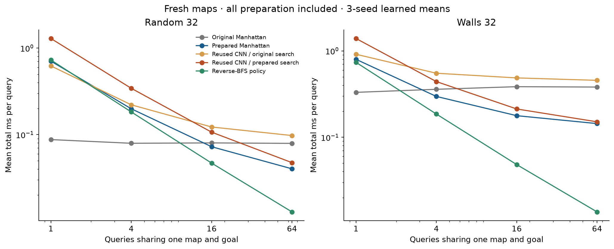
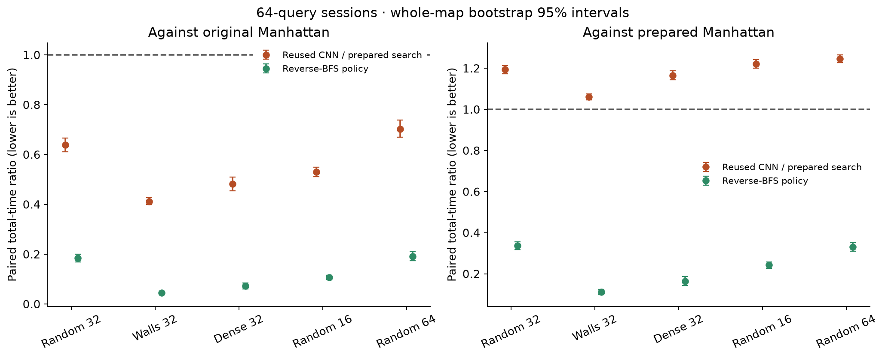

# Runtime and repeated-query results

This experiment follows the [fixed runtime plan](runtime_reuse.md). It keeps the three route-trained models unchanged and measures entire sessions, including map preparation and one prediction or reverse BFS where needed. It uses 300 new maps, excluding all 5,180 earlier layout groups. Each session contains 1, 4, 16, or 64 different starts sharing a goal.

Prepared search and reuse made the learned method faster than the original Manhattan implementation in 64-query sessions. However, equally prepared Manhattan was still faster in every condition. The learned method's mean paired time ratio was 1.194 on random 32×32 maps and 1.060 on wall maps. Reverse BFS with stored next steps was fastest among the measured methods in these 64-query sessions. Thus the largest runtime gain came from implementation and reuse, rather than from learned ordering.

## Complete session cost

Values are milliseconds per query: the measured session time divided by its query count, then averaged across maps. Five shuffled repetitions supply each session's median. Learned rows average seeds 7, 17, and 27. These workloads include unreachable queries. Model loading is outside timing; all map and goal preparation is inside.

### Random 32

| Method | 1 query | 4 queries | 16 queries | 64 queries |
| --- | ---: | ---: | ---: | ---: |
| Original Manhattan | 0.0875 | 0.0793 | 0.0801 | 0.0791 |
| Prepared Manhattan | 0.7060 | 0.1986 | 0.0723 | 0.0402 |
| Fresh CNN / ties | 0.6246 | — | — | — |
| Reused CNN / original search | 0.6217 | 0.2207 | 0.1223 | 0.0974 |
| Reused CNN / prepared search | 1.2906 | 0.3426 | 0.1065 | 0.0473 |
| Prepared exact A* | 0.8366 | 0.2254 | 0.0727 | 0.0341 |
| Reverse-BFS policy | 0.7281 | 0.1826 | 0.0468 | 0.0127 |

### Walls 32

| Method | 1 query | 4 queries | 16 queries | 64 queries |
| --- | ---: | ---: | ---: | ---: |
| Original Manhattan | 0.3309 | 0.3590 | 0.3850 | 0.3811 |
| Prepared Manhattan | 0.7984 | 0.2968 | 0.1776 | 0.1439 |
| Fresh CNN / ties | 0.9193 | — | — | — |
| Reused CNN / original search | 0.9135 | 0.5508 | 0.4863 | 0.4557 |
| Reused CNN / prepared search | 1.3908 | 0.4408 | 0.2125 | 0.1508 |
| Prepared exact A* | 0.8587 | 0.2431 | 0.0908 | 0.0509 |
| Reverse-BFS policy | 0.7365 | 0.1856 | 0.0482 | 0.0137 |

Fresh CNN predictions are measured only for single-query sessions. Reused predictions retain the original queue implementation; prepared search additionally uses integer cell IDs, precomputed neighbors, and once-validated score fields. Prepared Manhattan receives the same implementation changes. Reverse-BFS policy stores next steps and returns actual routes without an A* queue.

## Comparison on every condition

The table uses 64-query sessions. Ratios pair each map with its baseline, averaging the three learned models inside that map. Brackets are 95% intervals from 2,000 whole-map bootstrap samples. A ratio below one means less total time. Comparing against both Manhattan implementations prevents attributing a shared code speedup to learning.

| Condition | Reachable / queries | Learned / original Manhattan | Learned / prepared Manhattan | BFS policy / prepared Manhattan |
| --- | ---: | ---: | ---: | ---: |
| Random 32 | 3814 / 3840 | 0.639 [0.610, 0.666] | 1.194 [1.174, 1.214] | 0.337 [0.318, 0.356] |
| Walls 32 | 3840 / 3840 | 0.411 [0.399, 0.426] | 1.060 [1.046, 1.075] | 0.111 [0.100, 0.125] |
| Dense 32 | 1478 / 3840 | 0.482 [0.455, 0.510] | 1.165 [1.144, 1.187] | 0.164 [0.142, 0.186] |
| Random 16 | 3617 / 3840 | 0.530 [0.511, 0.548] | 1.221 [1.200, 1.242] | 0.244 [0.227, 0.258] |
| Random 64 | 3797 / 3840 | 0.703 [0.670, 0.738] | 1.246 [1.227, 1.265] | 0.330 [0.310, 0.351] |

## Where time goes

The following stage times are per query in 64-query sessions. Setup includes map preparation, a prediction or BFS where applicable, and planner creation. Stage medians are summarized independently, so they need not sum exactly to the total.

| Condition | Method | Setup ms/query | Search or path-following ms/query |
| --- | --- | ---: | ---: |
| Random 32 | Prepared Manhattan | 0.0106 | 0.0295 |
| Random 32 | Reused CNN / prepared search | 0.0200 | 0.0273 |
| Random 32 | Reverse-BFS policy | 0.0114 | 0.0013 |
| Walls 32 | Prepared Manhattan | 0.0108 | 0.1331 |
| Walls 32 | Reused CNN / prepared search | 0.0208 | 0.1300 |
| Walls 32 | Reverse-BFS policy | 0.0116 | 0.0020 |

## Scope and checks

At 64 queries, the learned search phase alone averaged 0.0273 ms versus prepared Manhattan's 0.0295 ms on random maps, and 0.1300 ms versus 0.1331 ms on walls. Its larger setup cost erased these small savings. Reusing predictions without changing the original queue implementation also remained slower than original Manhattan. The model was not retrained because this experiment targeted execution cost, while the previous round already established improved move choices.

The prepared implementations returned exactly the same paths and all search counters as their original counterparts on every measured query. This is an implementation comparison, not a new training result. All methods returned optimal paths and correct reachability; no limits were reached. The BFS policy still does work during preprocessing and while following paths. Session records retain its preprocessing expansion count, while query records retain path steps.

Reuse assumes a static map and unchanged goal. Any change requires new preparation. The results do not establish benefits for moving obstacles or changing goals. Intervals describe maps for three fixed models on this CPU. Correlated batch sizes are separate workload settings rather than extra independent samples.

Verified 64,500 timed sessions and 1,279,500 query executions. The [archive](../results/research_v4/) includes raw session repetitions, collapsed medians, query outcomes, checksums, dataset provenance, and PNG/PDF figures. The [third experiment](search_learning_results.md) remains the source for claims about learning quality and expansion reductions.
