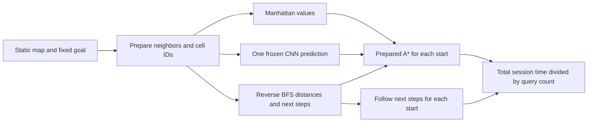

# Runtime and repeated queries

The third experiment improved move choices and reduced expansions, but remained slower than Manhattan A*. This round keeps its three route-trained models fixed. It tests whether avoiding repeated preparation changes that result. No new training or test-based model selection is involved.

## Workload and comparison

Each session has one static map, one goal, and 1, 4, 16, or 64 different starts. Smaller sessions use prefixes of the same sampled starts. A new session discards all prepared state. Model weights are loaded before timing, as in earlier rounds, but map preparation, feature encoding, prediction, BFS preprocessing, search, and returned paths are timed whenever the method needs them.

| Method | Preparation per session | Query method |
| --- | --- | --- |
| Original Manhattan | None | Existing A* implementation |
| Fresh learned ties | New CNN prediction for each query | Existing search; measured for one-query sessions |
| Reused learned ties | One CNN prediction | Existing search using that field |
| Prepared Manhattan | Integer cell IDs, neighbor lists, Manhattan values | Prepared A* |
| Prepared learned ties | Same map preparation plus one CNN prediction | Same prepared A*, prediction orders Manhattan ties |
| Prepared exact A* | Same map preparation plus reverse BFS | Same prepared A* with exact distances |
| Reverse-BFS policy | Same map preparation plus reverse BFS and next steps | Follow stored next steps; report no path if unreachable |

Every learned family uses seeds 7, 17, and 27. The two Manhattan baselines separate gains from implementation changes and gains from learned ordering. Exact A* is charged for building its distances. The BFS policy is also included because repeated queries to a fixed goal do not require rerunning A*: BFS can store a next step for every reachable cell.



The prepared search keeps neighbor order, reopening, stale-entry checks, goal-pop termination, path reconstruction, and all original counters. Finite scores are validated once when the planner is built. Every 3×3 layout and endpoint pair is checked against the original implementation, including exact paths and counters under deliberately incorrect secondary scores. The planner owns its frozen scores and is tied to its map and goal.

## Measurement rules

Engineering uses the earlier policy-validation maps. A preliminary profile uses the first 16 random and 16 wall maps, seed 7, four starts, and five repeats. Profiling adds overhead, so its times only identify where work occurs. Headline results come from unprofiled measurements.

After fixing the implementation, seed 44550 generates 300 fresh maps: 60 each of random 32×32, wall 32×32, dense 32×32, random 16×16, and random 64×64. All 5,180 earlier layout groups, including rotations, are excluded. Endpoints are sampled without requiring connectivity. Each method returns actual paths; labels are used only afterward to check path cost and reachability.

Each session is measured five times in shuffled method order on one CPU thread after warm-up. Every repetition starts without prepared map or goal state. Total session time includes preparation once; per-query time is that total divided by the number of starts. Stage medians are reported separately and need not sum exactly to the median total. All unreachable queries remain in the workload. Batch sizes are correlated views of a map, not independent samples.

Report each condition separately, with paired time ratios against both original and prepared Manhattan. Average the three trained seeds within each map, then bootstrap whole maps 2,000 times. These intervals describe these fixed models and this CPU workload. Report the BFS policy's preprocessing expansions separately from its path-following steps; calling its per-query search expansions zero would hide work done in preparation.

## Reproduction

```sh
python scripts/run_runtime_reuse.py prepare --run outputs/runtime_reproduction
python scripts/run_runtime_reuse.py evaluate --run outputs/runtime_reproduction
python scripts/report_runtime_reuse.py --run outputs/runtime_reproduction --output results/runtime_reproduction --report outputs/runtime_reproduction.md
```

The source datasets and three trained checkpoints listed in `configs/runtime_reuse.toml` must exist. The runner records hashes of settings, implementation, data, and model files, and rejects changes between preparation and evaluation. Generated map arrays stay local; compact measurements, manifests, verification, figures, and the final report are retained.
