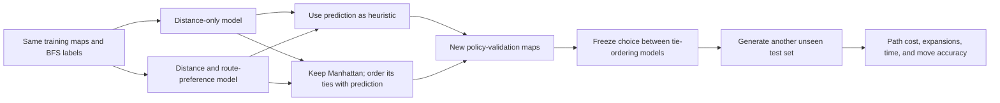

# Learning how to guide search

Manhattan A* remains the baseline. The earlier experiments showed that predicting wall distances more accurately did not necessarily improve search. This round changes both what the model learns and how search uses its output, with separate controls for those changes.

## Controlled comparison

The distance model is the existing 16-channel direct CNN trained in the second experiment. The route model uses the same architecture, training maps, optimizer, batch size, epoch budget, and seeds 7, 17, and 27. It adds a loss for choosing a useful neighboring move. The original distance models are reused so the comparison does not depend on a new draw of training maps.

| Training objective | Direct heuristic | Manhattan with learned tie ordering |
| --- | --- | --- |
| Distance only | Priority is `g + predicted distance` | Priority is `g + Manhattan`; prediction orders equal priorities |
| Distance and route preference | Same direct priority, new weights | Same Manhattan priority, new weights |

This separates the effect of the training objective from the effect of the search rule. A no-obstacle model supplies an additional tie-ordering control. Ordinary Manhattan A*, FIFO tie ordering, and Weighted A* at 1.5 remain explicit comparisons.

## What the route model learns

Reverse BFS supplies the distance from every reachable free cell to the goal. A neighbor is a good move if its distance is one step smaller. When several neighbors are equally good, any of them is accepted; the model is not forced to imitate one arbitrary route.

For each cell, predicted neighbor distances are converted back to steps. Lower predictions receive higher probabilities through a softmax with a one-step temperature. The route loss is the negative logarithm of the total probability assigned to good moves. The combined objective is `distance loss + 0.02 × route loss`. Goals, blocked cells, and unreachable cells do not supply move labels. Each map-goal example has equal weight. The coefficient is fixed for this round; it is not tuned on test results.

The model still outputs a distance field, rather than a separate action policy. The added objective teaches local move preferences through that field. Local move accuracy and whole-search quality are measured separately because frontier cells are not always neighbors.

## Search rule and guarantees

The usual baseline orders cells by `(g + Manhattan, -g, insertion order)`. The learned tie rule orders them by `(g + Manhattan, predicted distance, -g, insertion order)`. Thus it cannot move a cell ahead of another cell with a smaller primary A* priority.

Manhattan is consistent on this four-neighbor, unit-cost grid. With the primary priority retained and termination only when the goal leaves the queue, the tie rule preserves optimal path cost whenever the search completes. The prediction itself need not be admissible. It can still increase expansions or total time, so optimality does not imply an improvement.

Two exact-distance references diagnose the available improvement: exact distances as the primary heuristic, and exact distances only for ordering Manhattan ties. Their lookup timings exclude constructing the reference and are not practical runtime competitors. A separate fresh reverse-BFS method includes that construction. FIFO uses insertion order for primary ties; it is an extra control, not the main baseline to beat.

## Separation and selection

Training and checkpoint selection reuse the second experiment's 1,200 training and 240 validation maps. Another 240 maps, with seed 34549, select the search rule. They exclude all 4,340 layouts from earlier datasets, including rotations, and are not loaded by training.

Only the two learned tie-ordering families are selection candidates. Both must finish every validation query correctly and return optimal paths on every reachable query. Their score averages paired expansion ratios within each map and across the three seeds, then gives random and wall groups equal weight. The lower score wins, with the distance-only family winning an exact tie. If neither passes, no learned tie model is selected. A score at or above one is reported as no expansion improvement over Manhattan, even if it is the better learned candidate. Runtime is a separate outcome, not the selection score.

After this choice, seed 34550 generates 600 new test maps: 200 random 32×32 and 100 each of wall 32×32, dense 32×32, 16×16, and 64×64. The generator excludes every earlier layout and the new policy-validation layouts. All predeclared methods are measured on the same queries, with five shuffled repetitions, fresh model inference per query, and one CPU thread. Confidence intervals resample whole maps. The first wall map and first query provide the illustration, regardless of the outcome.

The primary question is whether useful learned ordering reduces search without losing optimality. A runtime claim additionally requires beating the total time of Manhattan A*, including model inference. No test result changes training or the selected search rule in this round.
