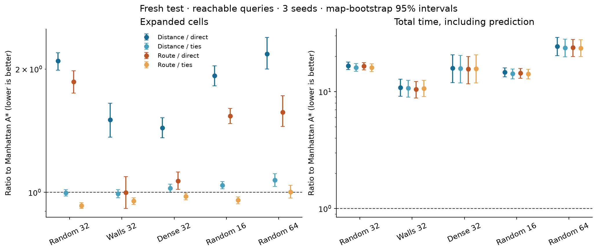
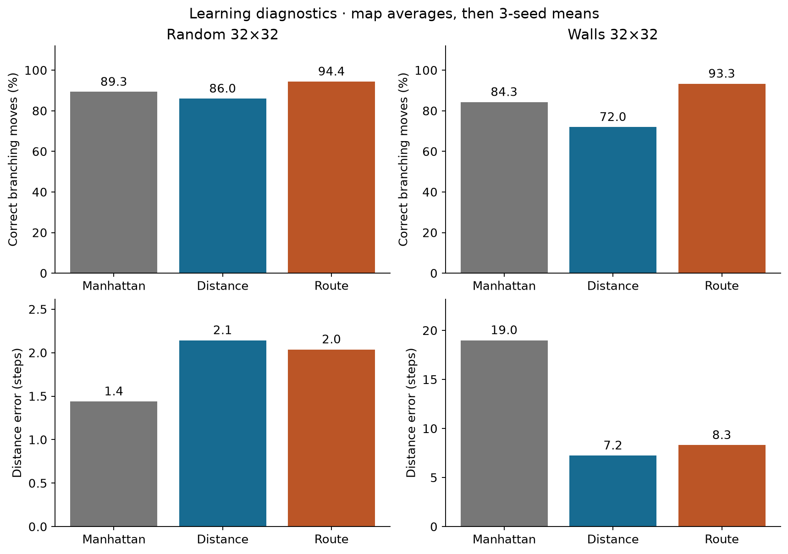
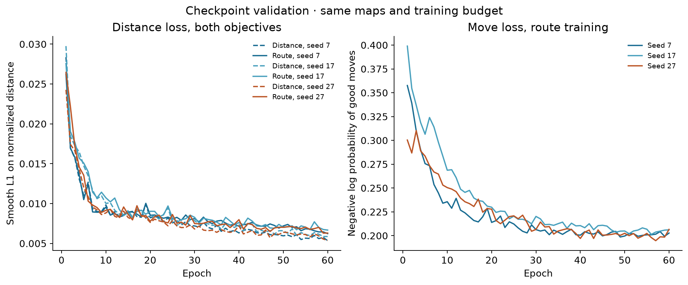
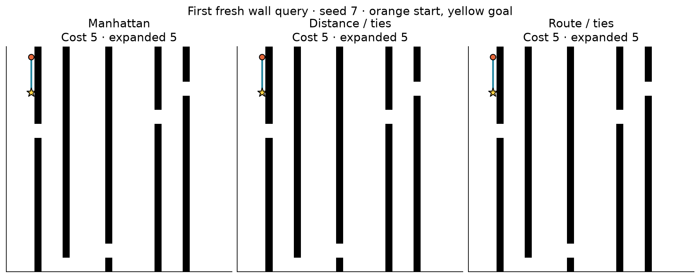

# Learning objectives and search rules: results

This round keeps Manhattan A* as the baseline and follows the [fixed comparison](search_learning.md). It separates two changes: adding a lesson about useful neighboring moves, and using predictions only to order equal Manhattan priorities. The [previous experiment](research_results.md) supplies the distance-only models; all methods are measured again on the same new queries.

The selected route-trained tie rule reduced paired reachable-query expansions by **7.2% on random 32×32 maps and 4.7% on wall maps**, with optimal paths on every reachable query in all five test groups. It did not improve total runtime. Its mean query times were 0.682 ms and 0.917 ms, respectively, versus 0.087 ms and 0.307 ms for Manhattan. The 64×64 expansion interval includes one, so that condition does not show a clear reduction.

## Training and selection

Three new models use the same 1,200 training maps, 240 checkpoint-validation maps, 16-channel architecture, optimizer, and seeds as the existing distance models. Each has 10,033 parameters. The added move objective accepts every neighboring step that reduces exact BFS distance by one. Its coefficient stays fixed at 0.02.

All three runs completed 60 epochs in 8.57 minutes in total. Checkpoint epochs for seeds 7, 17, and 27 are 60, 56, 59. Route checkpoints minimize combined distance and move loss; the earlier distance checkpoints minimize distance loss alone. The training figure compares the shared distance component, so the two different total losses are not treated as equivalent.

A separate 240-map policy-validation set chooses between the two learned tie families. The score gives random and wall groups equal weight and uses paired reachable-query expansion ratios. Both families must complete all queries correctly and keep optimal path cost. A score below one means fewer expansions than Manhattan.

| Candidate | Validation expansion score | Quality gate |
| --- | ---: | --- |
| distance / ties | 0.999 | Pass |
| route / ties | 0.942 | Pass |

The fixed rule selected **route / ties**. It reduced the validation expansion score below one.

Only then were 600 fresh test maps generated, giving 2,400 queries. These maps and the policy-validation maps are disjoint from all 4,340 earlier layout groups, including rotations. Test results did not change the models or selected rule.

## Fresh test: learning and search are separate factors

Times include one fresh prediction per query and use the median of five shuffled repetitions on one CPU thread. Each CNN row averages three seeds. Expansions and time in the tables include unreachable queries; path quality uses successful queries. The default Manhattan baseline breaks ties by larger distance already traveled. FIFO is an extra control, not the baseline to beat.

### Random 32×32

| Method | Total ms | Expanded cells | Mean path ratio | Optimal paths |
| --- | ---: | ---: | ---: | ---: |
| Manhattan A* | 0.087 | 49.0 | 1.0000 | 100.0% |
| Manhattan with FIFO ties | 0.153 | 100.7 | 1.0000 | 100.0% |
| Weighted A* (1.5) | 0.070 | 39.3 | 1.0200 | 77.4% |
| Distance / direct | 0.721 | 84.3 | 1.0069 | 93.9% |
| Distance / ties | 0.684 | 47.4 | 1.0000 | 100.0% |
| Route / direct | 0.705 | 70.9 | 1.0025 | 97.0% |
| Route / ties | 0.682 | 45.1 | 1.0000 | 100.0% |
| No-obstacle / ties, seed 7 | 0.694 | 45.6 | 1.0000 | 100.0% |
| Exact distance / ties, lookup only | 0.101 | 42.5 | 1.0000 | 100.0% |
| Exact primary heuristic, lookup only | 0.062 | 29.2 | 1.0000 | 100.0% |
| Fresh reverse BFS + search | 0.629 | 29.2 | 1.0000 | 100.0% |

### Walls 32×32

| Method | Total ms | Expanded cells | Mean path ratio | Optimal paths |
| --- | ---: | ---: | ---: | ---: |
| Manhattan A* | 0.307 | 199.5 | 1.0000 | 100.0% |
| Manhattan with FIFO ties | 0.335 | 241.6 | 1.0000 | 100.0% |
| Weighted A* (1.5) | 0.304 | 200.2 | 1.0012 | 97.8% |
| Distance / direct | 0.863 | 187.9 | 1.0192 | 74.8% |
| Distance / ties | 0.914 | 195.8 | 1.0000 | 100.0% |
| Route / direct | 0.790 | 136.4 | 1.0012 | 97.7% |
| Route / ties | 0.917 | 193.5 | 1.0000 | 100.0% |
| No-obstacle / ties, seed 7 | 0.936 | 199.6 | 1.0000 | 100.0% |
| Exact distance / ties, lookup only | 0.366 | 193.0 | 1.0000 | 100.0% |
| Exact primary heuristic, lookup only | 0.087 | 38.6 | 1.0000 | 100.0% |
| Fresh reverse BFS + search | 0.673 | 38.6 | 1.0000 | 100.0% |

The exact lookup rows receive BFS distances in advance. Their timings exclude building that information, so they diagnose search behavior rather than establish practical speed. Fresh reverse BFS includes its construction. Exact information only in ties still cannot move a cell ahead of one with a smaller Manhattan priority.

## What did the added move objective teach?

Move accuracy chooses the legal neighbor with the lowest predicted distance and accepts any shortest-path step. Equal predictions use north, east, south, west order. Branching accuracy excludes cells where every legal move is good. Values average cells within maps, then maps and seeds; they are diagnostics, not search success rates.

| Predictor | Random: branching accuracy | Walls: branching accuracy | Random: MAE | Walls: MAE |
| --- | ---: | ---: | ---: | ---: |
| manhattan | 89.3% | 84.3% | 1.439 | 18.996 |
| distance | 86.0% | 72.0% | 2.143 | 7.246 |
| route | 94.4% | 93.3% | 2.037 | 8.306 |

The following comparison pairs the same test query and seed. Ratios divide route training by distance-only training, so values below one favor route training. Accuracy differences are percentage points. Intervals resample maps 2,000 times, retaining paired queries and the three fixed seeds.

| Condition | Branching accuracy difference | Direct expansion ratio | Tie expansion ratio |
| --- | ---: | ---: | ---: |
| Random 32 | 8.416 [7.834, 9.027] | 0.943 [0.912, 0.978] | 0.953 [0.943, 0.962] |
| Walls 32 | 21.340 [20.744, 21.934] | 0.712 [0.689, 0.735] | 0.966 [0.958, 0.974] |

## Selected rule on every fresh condition

The ratios below compare the validation-selected tie family with Manhattan A*. Each reachable query is paired with its baseline; queries and seeds are averaged within maps before the map average. These ratios need not equal division of the two overall means above. Brackets show 95% map-bootstrap intervals.

| Condition | Reachable / queries | Expansion ratio | Total-time ratio | Optimal paths |
| --- | ---: | ---: | ---: | ---: |
| test | 788 / 800 | 0.928 [0.913, 0.943] | 16.011 [14.815, 17.272] | 100.0% |
| walls | 400 / 400 | 0.953 [0.933, 0.971] | 10.637 [8.972, 12.459] | 100.0% |
| density_40 | 150 / 400 | 0.978 [0.959, 0.995] | 15.680 [11.978, 20.246] | 100.0% |
| size_16 | 385 / 400 | 0.957 [0.938, 0.976] | 14.161 [12.807, 15.512] | 100.0% |
| size_64 | 385 / 400 | 1.002 [0.966, 1.042] | 23.522 [19.627, 27.665] | 100.0% |

## Interpretation and limits

The added lesson improved branching-move accuracy from 86.0% to 94.4% on random maps and from 72.0% to 93.3% on wall maps. Wall distance error increased from 7.25 to 8.31 steps at the same time. This is evidence that learning useful ordering differs from minimizing distance error. All three route-trained seeds reduced the paired expansion ratio below one on both 32×32 groups.

Learning local moves and ranking the whole search frontier are different tasks. The added objective can improve neighboring preferences without producing a globally accurate distance field. The direct-heuristic controls reveal that tradeoff; using the same fields only for ties retains Manhattan's optimality guarantee whenever search completes.

Fewer expansions do not establish a faster method. CNN prediction and queue ordering have costs that the total-time measurements include. The test covers new layouts from the two training families plus unseen sizes and density. Confidence intervals describe variation across maps for these three models, not uncertainty across all possible training runs. The one-seed no-obstacle control is a diagnostic rather than a complete architecture comparison.

The no-obstacle model also reduces random-map expansions, so that result alone cannot establish learned obstacle reasoning. It does not show a clear reduction on wall maps. Even exact-distance tie lookup is slower than ordinary Manhattan in this implementation. Prediction reuse alone therefore may not remove the runtime gap; queue-ordering costs also need attention. A next experiment could profile those costs and compare shared map-goal predictions with equally shared BFS preprocessing, keeping setup time in the comparison.

All methods in this round use the same updated search implementation. Absolute timings should be compared within this round, not against earlier runs on different maps and system loads. The first wall query below is fixed by dataset order; it illustrates the routes without representing average performance.

## Figures and retained evidence

Evidence checks verified 91,200 validation and 228,000 test runs, their paired method coverage, five repetitions, median summaries, checkpoint hashes, and layout separation. The [result archive](../results/research_v3/) retains summaries, compressed query and map records, manifests, selection, and settings. [New checkpoints and histories](../artifacts/checkpoints/research_v3/) and PNG/PDF figures are included. Full timing repetitions and generated map arrays remain local. See the [experiment plan](search_learning.md#reproduction) to rerun.
